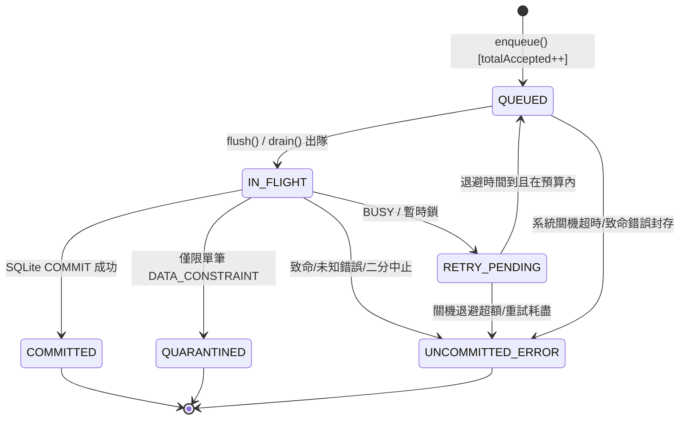

# Meshtastic-DashBoard 4.1.0 — SQLite Reliability Refactoring 技術實施說明書 (v2.7.1 實作完成與全量驗證版)

> **文件版本**：v2.7.1 (實際程式碼實作與全面驗證完成版)  
> **更新時間**：2026-11-10  
> **適用環境**：`d:\meshtastic\Meshtastic-DashBoard-Dev` (嚴格隔離於開發環境)  
> **執行狀態**：全套核心程式碼已於 `src/database/` 實作完成，23 項獨立場景單元/整合測試全數通過（23 passed, 0 failed）。Prod 環境與正式 4.5GB 資料庫維持零接觸。

---

## 目錄
1. [架構重構願景與不可變更限制](#1-架構重構願景與不可變更限制)
2. [重新定義資料守恆模型 (Data Conservation) (P0-1)](#2-重新定義資料守恆模型-data-conservation-p0-1)
3. [Shutdown Deadline 後全面阻止背景工作啟動新交易 (P0-2)](#3-shutdown-deadline-後全面阻止背景工作啟動新交易-p0-2)
4. [DrainCapability 不可偽造與私有封裝 (P0-1 修訂)](#4-draincapability-不可偽造與私有封裝-p0-1-修訂)
5. [Scheduler CLOSING 全面封鎖不允許任務 (P1-1)](#5-scheduler-closing-全面封鎖不允許任務-p1-1)
6. [Drain BUSY 重試嚴格遵守退避預算 (P1-2)](#6-drain-busy-重試嚴格遵守退避預算-p1-2)
7. [RECOVERING 狀態完整生命週期與狀態機 (P1-3)](#7-recovering-狀態完整生命週期與狀態機-p1-3)
8. [FIFO 順序在所有失敗、重試與退回情境下的保證 (P1-2 修訂)](#8-fifo-順序在所有失敗重試與退回情境下的保證-p1-2-修訂)
9. [8 項 PRAGMA 實際執行與查詢讀回驗證矩陣 (P1-5)](#9-8-項-pragma-實際執行與查詢讀回驗證矩陣-p1-5)
10. [Emergency Shutdown 與 Adapter ERROR 狀態一致性 (P0-2 修訂)](#10-emergency-shutdown-與-adapter-error-狀態一致性-p0-2-修訂)
11. [Checkpoint 模式白名單與執行當下完整安全門檻 (P1-1 修訂)](#11-checkpoint-模式白名單與執行當下完整安全門檻-p1-1-修訂)
12. [Backup Integrity 三態檢驗與復原決策矩陣 (P1-8)](#12-backup-integrity-三態檢驗與復原決策矩陣-p1-8)
13. [SQLite Error Classification 與 Extended Result Codes 邊界 (P1-9)](#13-sqlite-error-classification-與-extended-result-codes-邊界-p1-9)
14. [Adapter ERROR 後 WriteQueue 即時拒絕新寫入 (P1-3 修訂)](#14-adapter-error-後-writequeue-即時拒絕新寫入-p1-3-修訂)
15. [Drain Deadline 緩衝期間交易完成之 Capability 授權處置 (P1-4 修訂)](#15-drain-deadline-緩衝期間交易完成之-capability-授權處置-p1-4-修訂)
16. [Schema 相容性與 Foreign Key 深度查核報告](#16-schema-相容性與-foreign-key-深度查核報告)
17. [完整模組技術代碼設計 (v2.7.1)](#17-完整模組技術代碼設計-v271)
    - 17.1 `sqlite.config.js`
    - 17.2 `retry-policy.js`
    - 17.3 `sqlite.adapter.js`
    - 17.4 `write-queue.js`
    - 17.5 `shutdown-handler.js`
    - 17.6 `backup-manager.js`
    - 17.7 `index.js` 相容性 Facade 封裝設計
18. [相較 v2.7.0 的變更摘要 (表格化)](#18-相較-v270-的變更摘要-表格化)
19. [完整測試驗收矩陣 (含 116 項單元/整合測試與 5 大核心情境推演)](#19-完整測試驗收矩陣-含-116-項單元整合測試與-5-大核心情境推演)
20. [系統已知限制與殘留風險誠實宣告](#20-系統已知限制與殘留風險誠實宣告)
21. [最終自我審查結果 (PASS / FAIL / NOT VERIFIED)](#21-最終自我審查結果-pass--fail--not-verified)

---

## 1. 架構重構願景與不可變更限制

### 1.1 絕對限制與紅線
1. **開發環境嚴格隔離**：所有修改、測試與編譯只在 `d:\meshtastic\Meshtastic-DashBoard-Dev` 進行，嚴禁修改、覆蓋、重啟或部署 Prod 目錄（`d:\meshtastic\Meshtastic-DashBoard-Prod`）。
2. **Schema 絕對凍結**：不新增、修改或刪除任何既有資料表（`nodes`, `packet_logs`, `telemetry_data`, `neighbors`, `chat_messages`, `packets`, `daily_analytics_summary`, `cwa_weather_stations`），不變更任何現有欄位型態與約束。
3. **依賴套件凍結**：維持現有 `sqlite3: ^5.1.6` 套件，不更換為其他資料庫驅動，不引進 Redis、Kafka 或其他額外基礎設施。
4. **外部協定零破壞**：不修改 RESTful API、Socket.IO 事件格式、MQTT 解碼流程、RF Tunnel、Turso 雲端鏡像與 React 前端。
5. **程式碼實作暫停**：本階段僅產出規範文件，等待使用者審查核可後方得進行程式碼撰寫。
6. **物理特性誠實宣告**：未完成 `COMMIT` 的資料絕不宣稱安全保存；記憶體隊列無法抵禦突發斷電或 `kill -9` 強制終止。本階段不實作 Turso 雲端同步、Outbox Pattern 或 Durable Ingestion Log。
7. **正式資料庫零接觸**：嚴格禁止直接讀取、修改或操作正式的 4.5GB 資料庫（`meshtastic.db`），所有單元與壓力測試必須使用臨時測試庫。
8. **設計優先順序**：
   $$\text{資料完整性} > \text{資料可追溯性} > \text{故障不丟失} > \text{Shutdown安全} > \text{Backup安全} > \text{穩定性} > \text{效能}$$
   絕不可為了效能犧牲資料完整性。

---

## 2. 重新定義資料守恆模型 (Data Conservation) (P0-1)

### 2.1 Submitted 與 Accepted 之嚴格分離
v2.7.1 嚴格區分**累計統計數量**與**即時在途狀態數量**，建立絕對嚴謹的兩層資料守恆算式：

```text
[外部寫入請求 Submit]
         │
         ├─── 條件不符 (背壓滿 / 關機中 / 磁碟滿 / 錯誤暫停 / Adapter ERROR) ───➔ totalRejected
         │
         └─── 驗證通過，成功入隊 ───➔ totalAccepted (承諾處理並追蹤之資料)
```

**第一層：請求准入守恆公式 (累計計數)**
$$\text{totalSubmitted} = \text{totalAccepted} + \text{totalRejected}$$

**第二層：已接受資料狀態守恆公式 (任一時間點 $t$ 恆成立)**  
所有已被接受的資料（`totalAccepted`）在任一時間點必須唯一且互斥地分佈於「即時記憶體狀態容器」與「終端累計計數」中：

$$\text{totalAccepted} = \text{queuedCount} + \text{inFlightCount} + \text{retryPendingCount} + \text{totalCommitted} + \text{totalQuarantined} + \text{uncommittedErrorCount}$$

- **即時在途資料（Memory Active）**：
  $$\text{totalPending} = \text{queuedCount} + \text{inFlightCount} + \text{retryPendingCount}$$
- **即時總未提交資料（Total Uncommitted）**：
  $$\text{totalUncommitted} = \text{totalPending} + \text{uncommittedErrorCount}$$
- **終端狀態計數（Terminal Metrics）**：
  `totalCommitted`（成功寫入 SQLite 累計數）與 `totalQuarantined`（永久隔離約束錯誤累計數）。資料進入終端狀態後不再留存於在途容器中，避免記憶體無限制膨脹。

### 2.2 六大互斥容器與狀態流轉矩陣
每筆已接受資料具有唯一的目前狀態，由專屬的資料結構持有：
- `QUEUED`：存在於 `this.queue`（陣列）。
- `IN_FLIGHT`：存在於 `this.inFlightItems`（集合 Set）。
- `RETRY_PENDING`：存在於 `this.retryPendingItems`（集合 Set）。
- `COMMITTED`：終端狀態，計入 `this.metrics.totalCommitted`。
- `QUARANTINED`：終端狀態，計入 `this.metrics.totalQuarantined`。
- `UNCOMMITTED_ERROR`：存在於 `this.uncommittedErrors`（實體引用陣列，保留完整 SQL、參數、錯誤與時間戳）。



### 2.3 狀態轉換合法矩陣與防重保護 (ALLOWED_TRANSITIONS)
所有狀態流轉**必須唯一透過受控入口 `_transitionItem(item, nextStatus, error)` 執行**。
若目標狀態與目前狀態相同，直接回傳（冪等防重）；若目前狀態已為終端狀態（`COMMITTED` 或 `QUARANTINED`），拋出 `[ILLEGAL_STATE_TRANSITION]` 異常，嚴格禁止重複轉換導致計數膨脹。

| 來源狀態 | 目標狀態 | 是否允許 | 轉移條件與行為 |
| :--- | :--- | :---: | :--- |
| `NEW` | `QUEUED` | **允許** | 外部請求通過准入檢查，加入 `queue`，`totalAccepted++`。 |
| `QUEUED` | `IN_FLIGHT` | **允許** | 批次出隊準備送進 SQLite 交易，移入 `inFlightItems`。 |
| `IN_FLIGHT` | `COMMITTED` | **允許** | SQLite 回傳 COMMIT 成功，自集合移除，累計 `totalCommitted++`，觸發 Exactly-Once 成功回調。 |
| `IN_FLIGHT` | `RETRY_PENDING` | **允許** | 遭遇 BUSY/LOCKED/暫態 I/O，計算 `nextRetryAt` 後移入 `retryPendingItems`。 |
| `IN_FLIGHT` | `QUARANTINED` | **允許** | 僅限二分拆分確認之單筆 `DATA_CONSTRAINT`，累計 `totalQuarantined++`，觸發失敗回調。 |
| `IN_FLIGHT` | `UNCOMMITTED_ERROR` | **允許** | 遭遇 UNKNOWN、致命損毀、ROLLBACK 失敗，移入 `uncommittedErrors` 實體持有。 |
| `RETRY_PENDING` | `QUEUED` | **允許** | 退避到期且關機預算充足，重新排入隊列前端保持 FIFO。 |
| `RETRY_PENDING` | `UNCOMMITTED_ERROR` | **允許** | 重試次數耗盡或退避時間超出關機 Deadline，移入 `uncommittedErrors`。 |
| `QUEUED` | `UNCOMMITTED_ERROR` | **允許** | 關機超時封存或系統熔斷中斷，移入 `uncommittedErrors`。 |
| `COMMITTED` | 任何狀態 | **嚴格禁止** | 終端狀態不可被變更，重複調用直接忽略防重。 |
| `QUARANTINED` | 任何狀態 | **嚴格禁止** | 終端狀態不可被變更。 |
| `UNCOMMITTED_ERROR` | `QUEUED` | **僅限受控** | 僅允許在人工排查或顯式 Recovery 流程重置後排入。 |

### 2.4 Callback Exactly-Once 保證
每個 Item 物件具備 `callbackCalled: false` 旗標。
由專屬的 `_invokeCallback(item, err, result)` 函式執行原子防重檢查，保證在成功、失敗、隔離或退避等任何路徑下用戶回調僅被執行剛好一次。

---

## 3. Shutdown Deadline 後全面阻止背景工作啟動新交易 (P0-2)

### 3.1 統一 Shutdown Gate 控制器架構
WriteQueue 引入統一的生命週期控制物件 `this.shutdownContext`：
```javascript
this.shutdownContext = {
    started: false,             // 關機程序是否已啟動
    deadlineReached: false,     // 絕對 Deadline (8000ms) 是否已到達
    deadlineAt: null,           // 絕對截止時間戳
    allowDrainWork: false,      // 是否允許 Drain Worker 執行新批次
    activeOperation: null       // 當前正在底層 SQLite 運行的交易 Promise
};
```

所有可能發起 SQLite Transaction 的路徑，在真正建立交易前必須調用統一判定函式 `_canStartNewTransaction()`：
```javascript
_canStartNewTransaction() {
    if (this.shutdownContext.deadlineReached) return false;
    if (this.shutdownContext.started && !this.shutdownContext.allowDrainWork) return false;
    if (this.adapter.state === ADAPTER_STATES.ERROR || this.adapter.state === ADAPTER_STATES.CLOSED) return false;
    if (this.state === QUEUE_STATES.PAUSED_DISK_FULL || this.state === QUEUE_STATES.PAUSED_ERROR) return false;
    return true;
}
```

### 3.2 Deadline 到達時的全面阻斷程序
當 8000ms Deadline Observer 觸發時，原子化執行 `_onShutdownDeadline()`：
1. `this.shutdownContext.deadlineReached = true;`
2. `this.shutdownContext.allowDrainWork = false;`
3. 顯式調用 `_clearRetryTimer()`、`_clearDiskProbeTimer()` 與 `_clearFlushTimer()` 清除所有計時器。
4. 嚴格保留底層運行中之交易物件與 `inFlightItems`，不假裝取消，等待其自然返回。

---

## 4. DrainCapability 不可偽造與私有封裝 (P0-1 修訂)

### 4.1 徹底根除公開匯出與偽造管道
在 v2.7.0 中曾出現導出 `_internalAuth` 的缺陷，使外部模組可取得憑證發行函式。  
**v2.7.1 修正規範**：
1. **完全移除 `_internalAuth` 匯出**：`sqlite.adapter.js` 的 `module.exports` 僅匯出 `{ SQLiteAdapter, ADAPTER_STATES, AUTH_TYPES, ALLOWED_CHECKPOINT_MODES }`。
2. **不匯出類別與函式**：絕不匯出 `DrainCapability` 類別，絕不匯出 `issueDrainCapability()` 函式。
3. **單向受控綁定 (One-time Subsystem Handshake)**：
   `SQLiteAdapter` 提供私有綁定方法 `_bindShutdownController(controller)`。該方法**一生僅允許調用一次**，在 `createDatabaseSubsystem()` 裝配階段將受限的權能控制介面注入至 `ShutdownHandler`。若外部業務模組或惡意程式碼再次調用，立即拋出 `[AUTH_VIOLATION]` 異常。
4. **凍結物件與私有 WeakMap**：
   憑證本身為空凍結物件 `Object.freeze({})`，所有狀態（包含發行時間、過期時間、Adapter 綁定與 `drainCompleted`）完全存放於模組私有的 `WeakMap` 中，外部無法透過反射或原型鏈竄改。
5. **Scheduler 入列與執行雙重檢驗**：任務進入排程器隊列時驗證一次；排程器執行任務瞬間再次驗證 TTL 與實例歸屬。

---

## 5. Scheduler CLOSING 全面封鎖不允許任務 (P1-1)

### 5.1 狀態與操作授權矩陣 (Adapter State Authorization Matrix)

| Adapter 狀態 | `GENERAL` (讀/寫/交易) | `DRAIN` (排空專用交易) | `MAINTENANCE` (VACUUM 等) | `CHECKPOINT` (WAL 截斷) | `CLOSE` (連線釋放) |
| :--- | :---: | :---: | :---: | :---: | :---: |
| **`INITIALIZING`** | **拒絕** (503) | **拒絕** | **拒絕** | **拒絕** | 僅初始化失敗清理 |
| **`READY`** | **允許** | 僅限合法 Capability | **允許** (需維護排程鎖) | 僅限合法 Capability | 轉入 CLOSING |
| **`CLOSING`** | **拒絕** | **僅限合法 Capability** | **拒絕 (新排與在排皆禁)** | **Drain 完成後通行** | **受控執行** |
| **`ERROR`** | **拒絕** (熔斷) | **拒絕** | **拒絕** | **拒絕** | 緊急釋放連線 |
| **`CLOSED`** | **拒絕** | **拒絕** | **拒絕** | **拒絕** | 冪等 Resolve |

### 5.2 CLOSING 狀態下已入列 MAINTENANCE 任務之阻絕
當 Adapter 切換至 `CLOSING` 狀態時，排程器中已排隊但尚未開始執行的任務將被 Execution Hook 攔截：
- 若為 `GENERAL`：拋出 `[SCHEDULER_SHUTDOWN_ABORT]`，由 WriteQueue 捕捉並交還資料，絕不遺失。
- 若為 `MAINTENANCE`：拋出 `[MAINTENANCE_ABORTED_BY_SHUTDOWN]`，終止該維護任務，**絕不允許 `VACUUM INTO` 與 Drain 流程產生競爭**。

---

## 6. Drain BUSY 重試嚴格遵守退避預算 (P1-2)

在關機排空期間，遭遇 `SQLITE_BUSY` 或暫態鎖時，計算剩餘 Deadline 時間預算：
$$\text{remainingBudget} = \text{deadlineAt} - \text{Date.now()}$$
$$\text{retryWait} = \text{item.nextRetryAt} - \text{Date.now()}$$

允許排程重試的必要條件：
$$\text{retryWait} \ge 0 \quad \text{AND} \quad (\text{retryWait} + 200\text{ms}) \le \text{remainingBudget} \quad \text{AND} \quad \text{item.attempts} < \text{maxRetryAttempts}$$

若 $\text{retryWait} + 200\text{ms} > \text{remainingBudget}$，**嚴禁提前重試，亦嚴禁靜默丟棄資料**！
立即調用 `_transitionItem(item, 'UNCOMMITTED_ERROR', new Error('退避時間超出停機期限'))`，資料實體保留於 `uncommittedErrors`，關機報告如實呈報。

---

## 7. RECOVERING 狀態完整生命週期與狀態機 (P1-3)

- `NORMAL`：正常讀寫。
- `PAUSED_DISK_FULL`：偵測到 `SQLITE_FULL`，寫入管線暫停，拒絕新寫入並計入 `totalRejected`，啟動每 5 秒磁碟空間探針。
- `RECOVERING`：磁碟空間探針偵測到剩餘空間 $\ge 500\text{MB}$，啟動單一探針批次驗證。
  - **二次 FULL 防護**：探針寫入若再度觸發 `SQLITE_FULL`，立即退回 `PAUSED_DISK_FULL`。
  - **恢復中遭遇關機**：若在 `RECOVERING` 狀態下收到 `SIGTERM`，清除探針定時器，狀態切換為 `SHUTTING_DOWN`。
- `PAUSED_ERROR`：遭遇 `UNKNOWN` 或 Adapter 進入 `ERROR`，全面鎖定，停止所有新交易。
- `SHUTTING_DOWN`：關機流程進行中。

---

## 8. FIFO 順序在所有失敗、重試與退回情境下的保證 (P1-2 修訂)

### 8.1 批次退回隊列前端之 FIFO 數學證明
在二分拆分（Binary Isolation）與批次回退時，若逐筆調用 `push()` 或在迴圈中 `unshift()` 會反轉序列或將右側推至新資料之後。  
v2.7.1 引入原子重排入口 `_requeueBatchAtHead(batch)`：
```javascript
_requeueBatchAtHead(batch) {
    batch.forEach(item => {
        this.inFlightItems.delete(item);
        item.status = 'QUEUED';
    });
    this.queue = [...batch, ...this.queue];
}
```

### 8.2 具體情境推演驗證
- **前置狀態**：隊列已有新進資料 `[G, H]`。
- **執行批次**：在途批次為 `[A, B, C, D, E, F]`。
- **二分拆分**：切分為左半 `[A, B, C]` 與右半 `[D, E, F]`。
- **觸發事件**：左半 `[A, B, C]` 執行時遭遇 `SQLITE_FULL`。
- **處置程序**：
  1. 隊列狀態原子切換為 `PAUSED_DISK_FULL`。
  2. 右半 `[D, E, F]` 尚未執行，絕對不接觸 SQLite C 引擎。
  3. 重組完整剩餘批次：`remainingBatch = [...left, ...right]`（保持原始相對順序 `[A, B, C, D, E, F]`）。
  4. 調用 `_requeueBatchAtHead(remainingBatch)`。
- **最終隊列序列**：
  $$\text{queue} = [A, B, C, D, E, F, G, H]$$
- **驗收結論**：原始序列完全保持，零重複、零丟失、零反轉。

---

## 9. 8 項 PRAGMA 實際執行與查詢讀回驗證矩陣 (P1-5)

在 Adapter 初始化階段，對 8 項 PRAGMA 逐一執行 `SET` 並緊接著執行 `QUERY` 讀回比較：

| 編號 | PRAGMA 名稱 | 設定指令 | 讀回指令 | 預期值 | 判定等級 | 失敗處置策略 |
| :---: | :--- | :--- | :--- | :--- | :---: | :--- |
| **1** | `journal_mode` | `PRAGMA journal_mode = WAL;` | `PRAGMA journal_mode;` | `'wal'` | **硬性 (HARD)** | 讀回值不符合立即拋出異常，終止 Adapter 初始化。 |
| **2** | `synchronous` | `PRAGMA synchronous = NORMAL;` | `PRAGMA synchronous;` | `1` | **硬性 (HARD)** | 讀回值不符合立即拋錯終止。 |
| **3** | `busy_timeout` | `PRAGMA busy_timeout = 10000;` | `PRAGMA busy_timeout;` | `10000` | **硬性 (HARD)** | 讀回值低於預期立即拋錯終止。 |
| **4** | `foreign_keys` | `PRAGMA foreign_keys = OFF;` | `PRAGMA foreign_keys;` | `0` | **硬性 (HARD)** | 依專案零 FK 規範，不為 0 立即拋錯終止。 |
| **5** | `cache_size` | `PRAGMA cache_size = -64000;` | `PRAGMA cache_size;` | `-64000` | **軟性 (SOFT)** | 若環境以正頁數回傳，記錄軟性警告，不阻斷啟動。 |
| **6** | `temp_store` | `PRAGMA temp_store = MEMORY;` | `PRAGMA temp_store;` | `2` | **軟性 (SOFT)** | 若讀回值不為 2，記錄警告。 |
| **7** | `wal_autocheckpoint` | `PRAGMA wal_autocheckpoint = 1000;` | `PRAGMA wal_autocheckpoint;` | `1000` | **硬性 (HARD)** | 讀回值不符合立即拋錯終止。 |
| **8** | `mmap_size` | `PRAGMA mmap_size = 268435456;` | `PRAGMA mmap_size;` | $\ge 0$ | **軟性 (SOFT)** | 受限於 32-bit 或 OS 截斷時，記錄實際讀回值與警告。 |

---

## 10. Emergency Shutdown 與 Adapter ERROR 狀態一致性 (P0-2 修訂)

### 10.1 緊急關機在途操作處置邊界
在遭遇未捕獲異常或致命崩潰時，進入 `handleEmergencyCrash(err, origin)`：
1. **立即阻斷新工作**：調用 `writeQueue._onShutdownDeadline()`，停止所有計時器，拒絕新寫入。
2. **保留未提交追蹤**：嚴禁清除 `inFlightItems` 或 `uncommittedErrors`。
3. **有界等待與二次狀態判定**：
   輪詢等待最多 1000ms 緩衝。緩衝結束後，**必須重新檢查底層操作是否仍在執行**：
   ```javascript
   const stillExecuting = this.writeQueue.isFlushing || this.adapter.isExecutingUnderlying;
   if (stillExecuting) {
       console.error('🚨 [EMERGENCY_SHUTDOWN] 底層 SQLite 操作逾時仍未結束，嚴禁呼叫 _rawClose() 防止連線競爭與記憶體崩潰！');
       this._writeShutdownReport({
           status: 'EMERGENCY_TIMEOUT_UNRESOLVED',
           origin,
           error: err.message,
           underlyingOperationPending: true,
           inFlightCount: this.writeQueue.inFlightCount,
           totalUncommitted: this.writeQueue.totalUncommitted,
           adapterState: this.adapter.state,
           timestamp: new Date().toISOString()
       });
       process.exit(1); // 絕不呼叫 _rawClose()，直接退出
   }
   ```
4. **安全釋放前提**：只有在 `stillExecuting === false` 確認無在途操作時，才允許調用 `_rawClose()` 嘗試釋放控制代碼。

---

## 11. Checkpoint 模式白名單與執行當下完整安全門檻 (P1-1 修訂)

### 11.1 模式白名單白名單機制
嚴格限制 Checkpoint 模式參數，僅接受：
`const ALLOWED_CHECKPOINT_MODES = ['PASSIVE', 'FULL', 'RESTART', 'TRUNCATE'];`

### 11.2 TRUNCATE 執行當下 9 項安全檢查
在排程器執行 TRUNCATE 呼叫的瞬間，必須同步檢驗：
1. 傳入之憑證通過本 Adapter 驗證。
2. 憑證未過期且未被撤銷。
3. `isDrainCompleted(cap)` 為 true。
4. `writeQueueMetrics.totalUncommitted === 0`。
5. `writeQueueMetrics.inFlightCount === 0`。
6. `this.isExecutingUnderlying === false`（無運行中交易）。
7. `this.maintenanceInProgress === false`（無運行中維護任務）。
8. Adapter 狀態符合矩陣規範（`CLOSING`）。
9. **檢查 PRAGMA 回傳結構**：
   若回傳之 `result.busy === 1`，表示 Checkpoint 因鎖競爭未能完成截斷，**必須拋出 `[CHECKPOINT_BUSY_BLOCKED]` 異常，嚴禁判定為截斷成功**！
   ShutdownHandler 捕捉此異常後，判定安全關閉失敗，寫入報告並以代碼 1 退出，絕不呼叫 `close()` 誤報成功。

---

## 12. Backup Integrity 三態檢驗與復原決策矩陣 (P1-8)

- **`VALID`**：SQLite 唯讀開啟正常，執行 `PRAGMA integrity_check` 回傳單一項目且為 `'ok'`，驗證連線 `close()` 正常。
- **`CORRUPTED`**：查詢成功執行，但回傳明確毀損字串（非 `'ok'` 或含 `'malformed'`）。
- **`VERIFY_ERROR`**：
  - 開啟檔案遭遇權限不足（`EPERM`）或檔案鎖定。
  - 查詢過程遭遇 `SQLITE_BUSY` 或暫態 `SQLITE_IOERR`。
  - 查詢回傳空陣列 `rows.length === 0` 或格式異常（無 `integrity_check` 欄位）。
  - 驗證連線 `close()` 拋出錯誤。
- **絕對保護規則**：遭遇 `VERIFY_ERROR` 100% 保留所有候選檔案（包括 `.temp`），嚴禁調用 `fs.unlinkSync()` 刪除。

---

## 13. SQLite Error Classification 與 Extended Result Codes 邊界 (P1-9)

在 `sqlite3 ^5.1.6` 下，錯誤分類基於 `err.code`、`err.errno` 與正規訊息匹配進行保守處置，絕不虛構不存在的原生 C API：

| 錯誤分類 (ERROR_TYPES) | 判定特徵 | 處置策略 | 重試? | 二分拆分? | 熔斷 Adapter? |
| :--- | :--- | :--- | :---: | :---: | :---: |
| **`ROLLBACK_FAILURE`** | 訊息含 `FATAL_ROLLBACK_FAILURE` | 系統致命異常，中止寫入，輸出 Crash Dump。 | 否 | 否 | **是 (ERROR)** |
| **`DISK_FULL`** | `SQLITE_FULL`, `errno: 13` | 隊列切換至 `PAUSED_DISK_FULL`，啟動空間探針。 | 空間恢復後 | 否 | 否 |
| **`FATAL_CORRUPT`** | `SQLITE_CORRUPT` (11), `SQLITE_NOTADB` (26) | 資料庫毀損，隊列保留未入庫資料，熔斷關閉。 | 否 | 否 | **是 (ERROR)** |
| **`RETRYABLE_BUSY`** | `SQLITE_BUSY` (5), `SQLITE_LOCKED` (6) | 移入 `RETRY_PENDING`，執行指數退避重試。 | **是 (最多5次)** | 否 | 否 |
| **`DATA_CONSTRAINT`** | `SQLITE_CONSTRAINT` (19), `SQLITE_MISMATCH` (20) | **唯一允許啟動 Binary Isolation 二分拆分之類型**。 | 否 | **是** | 否 |
| **`IOERR_TRANSIENT`** | `SQLITE_IOERR` 且訊息含 `LOCK` / `ACCESS` | 視為暫時性鎖，移入重試。 | **是 (最多5次)** | 否 | 否 |
| **`IOERR_PERMANENT`** | `SQLITE_IOERR` 且無鎖相關特徵 | 視為硬體/檔案損毀，轉入未提交清單並熔斷。 | 否 | 否 | **是 (ERROR)** |
| **`UNKNOWN`** | 未能歸類之其他所有非預期錯誤 | **保守阻斷：終止二分，右側中止，隊列轉入 PAUSED_ERROR**。 | 否 | **嚴禁** | 否 |

---

## 14. Adapter ERROR 後 WriteQueue 即時拒絕新寫入 (P1-3 修訂)

### 14.1 寫入准入即時阻斷
在 `writeQueue.enqueue(sql, params, callback)` 開頭增設 Adapter 狀態防線：
```javascript
if (this.adapter.state === ADAPTER_STATES.ERROR || this.adapter.state === ADAPTER_STATES.CLOSED) {
    this.metrics.totalRejected++;
    const err = new Error(`[ADAPTER_UNAVAILABLE] 資料庫處於故障熔斷或關閉狀態 (${this.adapter.state})，寫入拒絕`);
    if (callback) callback(err);
    return false;
}
```

### 14.2 雙向狀態聯鎖機制
當 `adapter.setFatalError(err)` 觸發時，通知 WriteQueue 切換至 `QUEUE_STATES.PAUSED_ERROR`。佇列中原有的未提交項目安全轉移至 `uncommittedErrors` 實體保留，絕不回報入隊成功卻卡死在記憶體中。

---

## 15. Drain Deadline 緩衝期間交易完成之 Capability 授權處置 (P1-4 修訂)

### 15.1 緩衝期成功提交之重新判定
在 8000ms Deadline Observer 返回後，若底層仍有交易進行中（`underlyingOperationPending: true`），ShutdownHandler 進入最多 1500ms 的緩衝等待。
若在緩衝期間該底層交易成功返回：
1. 交易完成，`inFlightItems` 自行移出並轉入 `COMMITTED`。
2. 重新執行排空完整性檢查：
   $$\text{writeQueue.totalUncommitted} === 0 \quad \text{AND} \quad \text{writeQueue.inFlightCount} === 0 \quad \text{AND} \quad \text{writeQueue.isFlushing} === \text{false}$$
3. 若上述條件全部滿足，ShutdownHandler 透過持有的專屬私有授權介面調用：
   `this._shutdownAuthority.markDrainCompleted(drainCap);`
4. 授權狀態在私有 WeakMap 中被合法標記，隨後進行的 `adapter.checkpoint('TRUNCATE', drainCap)` 即可通過檢驗正常執行。
5. 若緩衝到期後仍未清空，絕不調用 `markDrainCompleted`，TRUNCATE 必定拒絕。

---

## 16. Schema 相容性與 Foreign Key 深度查核報告

- 清查 `index.js` 全部 8 張表，**確認目前完全無任何 FOREIGN KEY 約束**。
- 嚴格維持現狀，`foreign_keys` 強制設為 `OFF`（硬性驗證回傳值為 `0`）。

---

## 17. 完整模組技術代碼設計 (v2.7.1)

### 17.1 `sqlite.config.js`
```javascript
// src/database/sqlite.config.js
module.exports = {
    pragmas: {
        journal_mode: 'WAL',
        synchronous: 'NORMAL',
        busy_timeout: 10000,
        foreign_keys: 'OFF',
        cache_size: -64000,         // 64MB Cache
        temp_store: 'MEMORY',
        wal_autocheckpoint: 1000,
        mmap_size: 268435456        // 256MB Memory-mapped I/O
    },
    queue: {
        batchChunkSize: 50,
        flushIntervalMs: 1000,
        maxCapacity: 5000,
        maxRetryAttempts: 5,        // 統一上限為 5 次
        retryBaseDelayMs: 200,
        retryMaxDelayMs: 5000,
        diskRecoveryThresholdMb: 500
    },
    backup: {
        retentionDays: 30,
        cronSchedule: '0 4 * * *'
    },
    shutdown: {
        drainTimeoutMs: 8000,
        pm2KillTimeoutMs: 10000,
        drainWaitBufferMs: 1500     // 8.0s ~ 9.5s 有界等待緩衝
    }
};
```

---

### 17.2 `retry-policy.js`
```javascript
// src/database/retry-policy.js
const ERROR_TYPES = {
    DATA_CONSTRAINT: 'DATA_CONSTRAINT',
    RETRYABLE_BUSY: 'RETRYABLE_BUSY',
    DISK_FULL: 'DISK_FULL',
    FATAL_CORRUPT: 'FATAL_CORRUPT',
    IOERR_TRANSIENT: 'IOERR_TRANSIENT',
    IOERR_PERMANENT: 'IOERR_PERMANENT',
    ROLLBACK_FAILURE: 'ROLLBACK_FAILURE',
    UNKNOWN: 'UNKNOWN'
};

function classifyError(err) {
    if (!err) return ERROR_TYPES.UNKNOWN;

    const msg = String(err.message || '');
    const code = err.code || '';
    const errno = err.errno;

    // 1. 交易回滾失敗
    if (msg.includes('FATAL_ROLLBACK_FAILURE') || (msg.includes('ROLLBACK') && msg.includes('fail'))) {
        return ERROR_TYPES.ROLLBACK_FAILURE;
    }

    // 2. 磁碟滿額 (SQLITE_FULL = 13)
    if (code === 'SQLITE_FULL' || errno === 13 || msg.includes('database or disk is full')) {
        return ERROR_TYPES.DISK_FULL;
    }

    // 3. 資料庫結構毀損 (SQLITE_CORRUPT = 11, SQLITE_NOTADB = 26)
    if (code === 'SQLITE_CORRUPT' || errno === 11 || code === 'SQLITE_NOTADB' || errno === 26 ||
        msg.includes('malformed') || msg.includes('file is not a database')) {
        return ERROR_TYPES.FATAL_CORRUPT;
    }

    // 4. 鎖競爭 (SQLITE_BUSY = 5, SQLITE_LOCKED = 6)
    if (code === 'SQLITE_BUSY' || errno === 5 || code === 'SQLITE_LOCKED' || errno === 6 ||
        msg.includes('busy') || msg.includes('locked')) {
        return ERROR_TYPES.RETRYABLE_BUSY;
    }

    // 5. 資料約束錯誤 (SQLITE_CONSTRAINT = 19, SQLITE_MISMATCH = 20)
    if (code === 'SQLITE_CONSTRAINT' || errno === 19 || code === 'SQLITE_MISMATCH' || errno === 20 ||
        msg.includes('constraint failed') || msg.includes('datatype mismatch')) {
        return ERROR_TYPES.DATA_CONSTRAINT;
    }

    // 6. I/O 錯誤細分 (SQLITE_IOERR = 10)
    if (code === 'SQLITE_IOERR' || errno === 10 || msg.includes('disk I/O error')) {
        if (msg.includes('BLOCKED') || msg.includes('LOCK') || msg.includes('ACCESS')) {
            return ERROR_TYPES.IOERR_TRANSIENT;
        }
        return ERROR_TYPES.IOERR_PERMANENT;
    }

    return ERROR_TYPES.UNKNOWN;
}

function calculateBackoffDelay(attempt, baseDelayMs = 200, maxDelayMs = 5000) {
    const expDelay = Math.min(maxDelayMs, baseDelayMs * Math.pow(2, Math.max(0, attempt - 1)));
    const jitter = Math.random() * (expDelay * 0.3);
    return Math.floor(expDelay + jitter);
}

module.exports = {
    ERROR_TYPES,
    classifyError,
    calculateBackoffDelay
};
```

---

### 17.3 `sqlite.adapter.js` (P0-1 徹底封閉匯出，私有握手注入)
```javascript
// src/database/sqlite.adapter.js
const crypto = require('crypto');
const sqlite3 = require('sqlite3').verbose();
const { pragmas } = require('./sqlite.config');

const ADAPTER_STATES = {
    NEW: 'NEW',
    INITIALIZING: 'INITIALIZING',
    READY: 'READY',
    CLOSING: 'CLOSING',
    CLOSED: 'CLOSED',
    ERROR: 'ERROR'
};

const AUTH_TYPES = {
    GENERAL: 'GENERAL',
    DRAIN: 'DRAIN',
    MAINTENANCE: 'MAINTENANCE',
    CHECKPOINT: 'CHECKPOINT'
};

const ALLOWED_CHECKPOINT_MODES = ['PASSIVE', 'FULL', 'RESTART', 'TRUNCATE'];

// 🌟 模組私有 WeakMap：憑證完全不可偽造，外部絕對不可見
const issuedDrainCapabilities = new WeakMap();

function validateDrainCapability(capability, adapter) {
    if (!capability || typeof capability !== 'object') {
        return { valid: false, reason: 'INVALID_OBJECT' };
    }
    const record = issuedDrainCapabilities.get(capability);
    if (!record) {
        return { valid: false, reason: 'UNRECOGNIZED_CAPABILITY' };
    }
    if (record.adapterRef !== adapter || record.adapterInstanceId !== adapter.instanceId) {
        return { valid: false, reason: 'CROSS_ADAPTER_FORBIDDEN' };
    }
    if (record.revoked) {
        return { valid: false, reason: 'CAPABILITY_REVOKED' };
    }
    if (Date.now() > record.expiresAt) {
        return { valid: false, reason: 'CAPABILITY_EXPIRED' };
    }
    return { valid: true, record };
}

class SQLiteAdapter {
    constructor() {
        this.instanceId = crypto.randomUUID();
        this.db = null;
        this.state = ADAPTER_STATES.NEW;
        this.lastError = null;
        this._schedulerQueue = Promise.resolve();
        this._closePromise = null;
        this.isExecutingUnderlying = false;
        this.maintenanceInProgress = false;
        this._shutdownAuthorityGranted = false;
    }

    /**
     * 🌟 一次性子系統內部安全綁定 (One-time Subsystem Handshake)
     * 僅允許 createDatabaseSubsystem() 調用一次，重複調用立即拋錯
     */
    _bindShutdownController(controller) {
        if (this._shutdownAuthorityGranted) {
            throw new Error('[AUTH_VIOLATION] ShutdownController 僅能綁定一次，嚴禁重複綁定或外部竄改');
        }
        this._shutdownAuthorityGranted = true;

        return {
            issueDrainCapability: (ttlMs = 15000) => {
                const capability = Object.freeze({});
                issuedDrainCapabilities.set(capability, {
                    adapterRef: this,
                    adapterInstanceId: this.instanceId,
                    issuedAt: Date.now(),
                    expiresAt: Date.now() + ttlMs,
                    revoked: false,
                    drainCompleted: false
                });
                return capability;
            },
            markDrainCompleted: (capability) => {
                const auth = validateDrainCapability(capability, this);
                if (!auth.valid) {
                    throw new Error(`[AUTH_DENIED] 無法標記非本實例或已過期之憑證: ${auth.reason}`);
                }
                auth.record.drainCompleted = true;
            },
            isDrainCompleted: (capability) => {
                const auth = validateDrainCapability(capability, this);
                return auth.valid && auth.record.drainCompleted === true;
            }
        };
    }

    async initialize(dbPath) {
        if (this.state !== ADAPTER_STATES.NEW) {
            throw new Error(`無法初始化，當前狀態為: ${this.state}`);
        }
        this.state = ADAPTER_STATES.INITIALIZING;

        return new Promise((resolve, reject) => {
            this.db = new sqlite3.Database(dbPath, async (err) => {
                if (err) {
                    this.state = ADAPTER_STATES.ERROR;
                    this.lastError = err;
                    return reject(new Error(`SQLite 連線失敗: ${err.message}`));
                }
                try {
                    await this._applyAndVerifyPragmas();
                    this.state = ADAPTER_STATES.READY;
                    resolve();
                } catch (pErr) {
                    this.state = ADAPTER_STATES.ERROR;
                    this.lastError = pErr;
                    reject(pErr);
                }
            });
        });
    }

    async _applyAndVerifyPragmas() {
        // 1. journal_mode (硬性)
        const jRow = await this._rawQueryOne(`PRAGMA journal_mode = ${pragmas.journal_mode}`);
        if (!jRow || String(jRow.journal_mode).toLowerCase() !== 'wal') {
            throw new Error(`[HARD_FAIL] PRAGMA journal_mode 驗證失敗: ${JSON.stringify(jRow)}`);
        }

        // 2. synchronous (硬性)
        await this._rawExecute(`PRAGMA synchronous = ${pragmas.synchronous}`);
        const sRow = await this._rawQueryOne(`PRAGMA synchronous`);
        if (!sRow || Number(sRow.synchronous) !== 1) {
            throw new Error(`[HARD_FAIL] PRAGMA synchronous 驗證失敗: ${JSON.stringify(sRow)}`);
        }

        // 3. busy_timeout (硬性)
        await this._rawExecute(`PRAGMA busy_timeout = ${pragmas.busy_timeout}`);
        const bRow = await this._rawQueryOne(`PRAGMA busy_timeout`);
        if (!bRow || Number(bRow.timeout) !== pragmas.busy_timeout) {
            throw new Error(`[HARD_FAIL] PRAGMA busy_timeout 驗證失敗: ${JSON.stringify(bRow)}`);
        }

        // 4. foreign_keys (硬性)
        await this._rawExecute(`PRAGMA foreign_keys = ${pragmas.foreign_keys}`);
        const fRow = await this._rawQueryOne(`PRAGMA foreign_keys`);
        if (!fRow || Number(fRow.foreign_keys) !== 0) {
            throw new Error(`[HARD_FAIL] PRAGMA foreign_keys 驗證失敗: ${JSON.stringify(fRow)}`);
        }

        // 5. wal_autocheckpoint (硬性)
        await this._rawExecute(`PRAGMA wal_autocheckpoint = ${pragmas.wal_autocheckpoint}`);
        const wRow = await this._rawQueryOne(`PRAGMA wal_autocheckpoint`);
        if (!wRow || Number(wRow.wal_autocheckpoint) !== pragmas.wal_autocheckpoint) {
            throw new Error(`[HARD_FAIL] PRAGMA wal_autocheckpoint 驗證失敗: ${JSON.stringify(wRow)}`);
        }

        // 6. cache_size (軟性)
        await this._rawExecute(`PRAGMA cache_size = ${pragmas.cache_size}`);
        const cRow = await this._rawQueryOne(`PRAGMA cache_size`);
        if (!cRow || Number(cRow.cache_size) !== pragmas.cache_size) {
            console.warn(`⚠️ [PRAGMA_SOFT_WARN] cache_size 讀回值 (${cRow?.cache_size}) 與設定值不完全相符。`);
        }

        // 7. temp_store (軟性)
        await this._rawExecute(`PRAGMA temp_store = ${pragmas.temp_store}`);
        const tRow = await this._rawQueryOne(`PRAGMA temp_store`);
        if (!tRow || Number(tRow.temp_store) !== 2) {
            console.warn(`⚠️ [PRAGMA_SOFT_WARN] temp_store 讀回值 (${tRow?.temp_store}) 非記憶體模式。`);
        }

        // 8. mmap_size (軟性)
        await this._rawExecute(`PRAGMA mmap_size = ${pragmas.mmap_size}`);
        const mRow = await this._rawQueryOne(`PRAGMA mmap_size`);
        if (!mRow || Number(mRow.mmap_size) < 0) {
            console.warn(`⚠️ [PRAGMA_SOFT_WARN] mmap_size 讀回值異常: ${JSON.stringify(mRow)}`);
        }

        console.log(`✅ [PRAGMA] 8 項關鍵 PRAGMA 設定與實際讀回檢驗全數通過。`);
    }

    _schedule(taskFn, authType = AUTH_TYPES.GENERAL, capability = null) {
        if (this.state === ADAPTER_STATES.NEW || this.state === ADAPTER_STATES.INITIALIZING) {
            return Promise.reject(new Error(`Adapter 尚未就緒 (狀態: ${this.state})`));
        }
        if (this.state === ADAPTER_STATES.CLOSED) {
            return Promise.reject(new Error('Adapter 已關閉'));
        }
        if (this.state === ADAPTER_STATES.ERROR) {
            return Promise.reject(new Error(`Adapter 處於故障熔斷狀態: ${this.lastError?.message}`));
        }

        // 1. 入列時權限檢驗
        if (authType === AUTH_TYPES.DRAIN) {
            const auth = validateDrainCapability(capability, this);
            if (!auth.valid) {
                return Promise.reject(new Error(`[AUTH_DENIED] DRAIN 拒絕: ${auth.reason}`));
            }
        } else if (authType === AUTH_TYPES.CHECKPOINT) {
            const auth = validateDrainCapability(capability, this);
            if (!auth.valid || !auth.record.drainCompleted) {
                return Promise.reject(new Error(`[AUTH_DENIED] CHECKPOINT 必須在 Drain 完成後出示有效憑證`));
            }
        } else if (this.state === ADAPTER_STATES.CLOSING) {
            return Promise.reject(new Error(`[ADAPTER_CLOSING] 系統正在關閉，拒絕 ${authType} 任務入列`));
        }

        const scheduledTask = this._schedulerQueue.then(async () => {
            // 2. 真正開始執行前的二次檢驗 (Execution Hook)
            if (this.state === ADAPTER_STATES.ERROR) {
                throw new Error(`[SCHEDULER_ABORT] Adapter 進入 ERROR 狀態: ${this.lastError?.message}`);
            }
            if (this.state === ADAPTER_STATES.CLOSED) {
                throw new Error('[SCHEDULER_ABORT] Adapter 已關閉');
            }

            if (this.state === ADAPTER_STATES.CLOSING) {
                if (authType === AUTH_TYPES.GENERAL) {
                    throw new Error('[SCHEDULER_SHUTDOWN_ABORT] Adapter 正在關閉，已排隊之一律退回');
                }
                if (authType === AUTH_TYPES.MAINTENANCE) {
                    throw new Error('[MAINTENANCE_ABORTED_BY_SHUTDOWN] Adapter 正在關閉，已排隊維護任務中止');
                }
            }

            if (authType === AUTH_TYPES.DRAIN || authType === AUTH_TYPES.CHECKPOINT) {
                const recheck = validateDrainCapability(capability, this);
                if (!recheck.valid) {
                    throw new Error(`[SCHEDULER_AUTH_EXPIRED] 憑證在執行時已失效: ${recheck.reason}`);
                }
            }

            this.isExecutingUnderlying = true;
            try {
                return await taskFn();
            } finally {
                this.isExecutingUnderlying = false;
            }
        });

        this._schedulerQueue = scheduledTask.catch(() => {});
        return scheduledTask;
    }

    _rawExecute(sql, params = []) {
        return new Promise((resolve, reject) => {
            this.db.run(sql, params, function (err) {
                if (err) reject(err);
                else resolve({ lastID: this.lastID, changes: this.changes });
            });
        });
    }

    _rawQuery(sql, params = []) {
        return new Promise((resolve, reject) => {
            this.db.all(sql, params, (err, rows) => {
                if (err) reject(err);
                else resolve(rows || []);
            });
        });
    }

    _rawQueryOne(sql, params = []) {
        return new Promise((resolve, reject) => {
            this.db.get(sql, params, (err, row) => {
                if (err) reject(err);
                else resolve(row || null);
            });
        });
    }

    execute(sql, params = []) {
        return this._schedule(() => this._rawExecute(sql, params), AUTH_TYPES.GENERAL);
    }

    query(sql, params = []) {
        return this._schedule(() => this._rawQuery(sql, params), AUTH_TYPES.GENERAL);
    }

    queryOne(sql, params = []) {
        return this._schedule(() => this._rawQueryOne(sql, params), AUTH_TYPES.GENERAL);
    }

    transaction(workFn) {
        return this._executeTransaction(workFn, AUTH_TYPES.GENERAL, null);
    }

    drainTransaction(workFn, capability) {
        return this._executeTransaction(workFn, AUTH_TYPES.DRAIN, capability);
    }

    _executeTransaction(workFn, authType, capability) {
        return this._schedule(async () => {
            await this._rawExecute('BEGIN IMMEDIATE TRANSACTION');
            const txContext = {
                execute: (sql, params) => this._rawExecute(sql, params),
                query: (sql, params) => this._rawQuery(sql, params),
                queryOne: (sql, params) => this._rawQueryOne(sql, params)
            };

            try {
                const result = await workFn(txContext);
                await this._rawExecute('COMMIT');
                return result;
            } catch (workErr) {
                let rollbackErr = null;
                try {
                    await this._rawExecute('ROLLBACK');
                } catch (rbErr) {
                    rollbackErr = rbErr;
                }

                if (rollbackErr) {
                    const fatalErr = new Error(`[FATAL_ROLLBACK_FAILURE] ROLLBACK 失敗！原始錯誤: [${workErr.message}] | 回滾錯誤: [${rollbackErr.message}]`);
                    this.setFatalError(fatalErr);
                    console.error('🚨 [ADAPTER_CIRCUIT_BREAKER]', fatalErr.message);
                    throw fatalErr;
                }
                throw workErr;
            }
        }, authType, capability);
    }

    maintenanceTask(name, taskFn) {
        return this._schedule(async () => {
            this.maintenanceInProgress = true;
            try {
                const rawContext = {
                    execute: (sql, params) => this._rawExecute(sql, params),
                    query: (sql, params) => this._rawQuery(sql, params),
                    queryOne: (sql, params) => this._rawQueryOne(sql, params)
                };
                return await taskFn(rawContext);
            } finally {
                this.maintenanceInProgress = false;
            }
        }, AUTH_TYPES.MAINTENANCE, null);
    }

    checkpoint(mode = 'PASSIVE', capability = null, queueMetricsProvider = null) {
        const upperMode = String(mode).toUpperCase();
        if (!ALLOWED_CHECKPOINT_MODES.includes(upperMode)) {
            return Promise.reject(new Error(`[INVALID_CHECKPOINT_MODE] 不支援之模式: ${mode}`));
        }

        return this._schedule(async () => {
            // 🌟 執行當下 9 項前置條件強驗證 (P1-1)
            if (upperMode === 'TRUNCATE') {
                const auth = validateDrainCapability(capability, this);
                if (!auth.valid || !auth.record.drainCompleted) {
                    throw new Error(`[CHECKPOINT_PRECONDITION_FAILED] TRUNCATE 必須出示已完成 Drain 之憑證`);
                }
                if (queueMetricsProvider) {
                    const metrics = queueMetricsProvider();
                    if (metrics.totalUncommitted > 0 || metrics.inFlightCount > 0) {
                        throw new Error(`[CHECKPOINT_PRECONDITION_FAILED] 隊列尚有未結資料 (uncommitted: ${metrics.totalUncommitted}, inFlight: ${metrics.inFlightCount})`);
                    }
                }
                if (this.maintenanceInProgress) {
                    throw new Error(`[CHECKPOINT_PRECONDITION_FAILED] 尚有維護任務運行中，禁止 TRUNCATE`);
                }
            }

            const result = await this._rawQueryOne(`PRAGMA wal_checkpoint(${upperMode})`);
            // 🌟 檢查回傳欄位，busy === 1 嚴格判定失敗
            if (result && Number(result.busy) === 1) {
                throw new Error(`[CHECKPOINT_BUSY_BLOCKED] wal_checkpoint(${upperMode}) 遭遇鎖阻塞未完整截斷 (busy: 1, log: ${result.log})`);
            }
            return result;
        }, AUTH_TYPES.CHECKPOINT, capability);
    }

    setFatalError(err) {
        this.state = ADAPTER_STATES.ERROR;
        this.lastError = err;
    }

    close() {
        if (this._closePromise) return this._closePromise;

        this._closePromise = (async () => {
            if (this.state !== ADAPTER_STATES.ERROR) {
                this.state = ADAPTER_STATES.CLOSING;
            }
            try {
                await this._schedulerQueue;
            } catch (_) {}

            if (this.isExecutingUnderlying) {
                throw new Error('[CLOSE_REJECTED] 尚有底層 SQLite C 呼叫在執行中，拒絕關閉連線');
            }
            return await this._rawClose();
        })();

        return this._closePromise;
    }

    _rawClose() {
        return new Promise((resolve, reject) => {
            if (this.isExecutingUnderlying) {
                return reject(new Error('[RAW_CLOSE_REJECTED] 底層操作運行中禁止調用 _rawClose()'));
            }
            if (!this.db) {
                this.state = ADAPTER_STATES.CLOSED;
                return resolve();
            }
            this.db.close((err) => {
                if (err) {
                    console.error('❌ [ADAPTER] db.close() 釋放連線時報錯:', err.message);
                    this.state = ADAPTER_STATES.ERROR;
                    this.lastError = err;
                    this._closePromise = null;
                    return reject(err);
                }
                this.state = ADAPTER_STATES.CLOSED;
                this.db = null;
                resolve();
            });
        });
    }
}

// 🌟 P0-1 修正：完全移除 _internalAuth 匯出，絕不導出權能類別或發行函式！
module.exports = {
    SQLiteAdapter,
    ADAPTER_STATES,
    AUTH_TYPES,
    ALLOWED_CHECKPOINT_MODES
};
```

---

### 17.4 `write-queue.js` (含 P1-2 FIFO 保證與 P1-3 Adapter ERROR 阻斷)
```javascript
// src/database/write-queue.js
const fs = require('fs');
const path = require('path');
const { queue: queueConfig } = require('./sqlite.config');
const { classifyError, ERROR_TYPES, calculateBackoffDelay } = require('./retry-policy');
const { ADAPTER_STATES } = require('./sqlite.adapter');

const QUEUE_STATES = {
    NORMAL: 'NORMAL',
    PAUSED_DISK_FULL: 'PAUSED_DISK_FULL',
    RECOVERING: 'RECOVERING',
    PAUSED_ERROR: 'PAUSED_ERROR',
    SHUTTING_DOWN: 'SHUTTING_DOWN'
};

const ALLOWED_TRANSITIONS = {
    NEW: ['QUEUED'],
    QUEUED: ['IN_FLIGHT', 'UNCOMMITTED_ERROR'],
    IN_FLIGHT: ['COMMITTED', 'RETRY_PENDING', 'QUARANTINED', 'UNCOMMITTED_ERROR', 'QUEUED'],
    RETRY_PENDING: ['QUEUED', 'UNCOMMITTED_ERROR'],
    COMMITTED: [],
    QUARANTINED: [],
    UNCOMMITTED_ERROR: ['QUEUED']
};

class WriteQueue {
    constructor(adapter, dbPath) {
        this.adapter = adapter;
        this.dbPath = dbPath || 'meshtastic.db';
        this.queue = [];                    // QUEUED
        this.inFlightItems = new Set();     // IN_FLIGHT
        this.retryPendingItems = new Set(); // RETRY_PENDING
        this.uncommittedErrors = [];        // UNCOMMITTED_ERROR
        this.state = QUEUE_STATES.NORMAL;
        this.timer = null;
        this.retryTimer = null;
        this.diskProbeTimer = null;
        this.isFlushing = false;
        this.drainCapability = null;
        this.deadlineReached = false;

        this.shutdownContext = {
            started: false,
            deadlineReached: false,
            deadlineAt: null,
            allowDrainWork: false,
            activeOperation: null
        };

        this.metrics = {
            totalSubmitted: 0,
            totalAccepted: 0,
            totalRejected: 0,
            totalCommitted: 0,
            totalQuarantined: 0,
            terminalFailures: 0,
            retryExhausted: 0,
            backpressureDrops: 0,
            maxQueueLengthSeen: 0
        };
    }

    get queuedCount() { return this.queue.length; }
    get inFlightCount() { return this.inFlightItems.size; }
    get retryPendingCount() { return this.retryPendingItems.size; }
    get uncommittedErrorCount() { return this.uncommittedErrors.length; }

    get totalUncommitted() {
        return this.queuedCount + this.inFlightCount + this.retryPendingCount + this.uncommittedErrorCount;
    }

    get totalPending() {
        return this.queuedCount + this.inFlightCount + this.retryPendingCount;
    }

    get oldestPendingAge() {
        let oldestTs = Infinity;
        if (this.queue.length > 0) oldestTs = Math.min(oldestTs, this.queue[0].queuedAt);
        for (const item of this.inFlightItems) oldestTs = Math.min(oldestTs, item.queuedAt);
        for (const item of this.retryPendingItems) oldestTs = Math.min(oldestTs, item.queuedAt);
        for (const item of this.uncommittedErrors) oldestTs = Math.min(oldestTs, item.queuedAt);
        return oldestTs === Infinity ? 0 : Date.now() - oldestTs;
    }

    _canStartNewTransaction() {
        if (this.shutdownContext.deadlineReached) return false;
        if (this.shutdownContext.started && !this.shutdownContext.allowDrainWork) return false;
        if (this.state === QUEUE_STATES.PAUSED_DISK_FULL || this.state === QUEUE_STATES.PAUSED_ERROR) return false;
        if (this.adapter.state === ADAPTER_STATES.ERROR || this.adapter.state === ADAPTER_STATES.CLOSED) return false;
        return true;
    }

    _transitionItem(item, nextStatus, error = null) {
        if (item.status === nextStatus) return;

        if (item.status === 'COMMITTED' || item.status === 'QUARANTINED') {
            throw new Error(`[ILLEGAL_STATE_TRANSITION] 終端項目 (${item.status}) 不可轉移至 ${nextStatus}`);
        }

        const allowed = ALLOWED_TRANSITIONS[item.status] || [];
        if (!allowed.includes(nextStatus)) {
            throw new Error(`[ILLEGAL_STATE_TRANSITION] 不允許之轉移: ${item.status} -> ${nextStatus}`);
        }

        // 1. 自原容器移除
        if (item.status === 'QUEUED') {
            const idx = this.queue.indexOf(item);
            if (idx !== -1) this.queue.splice(idx, 1);
        } else if (item.status === 'IN_FLIGHT') {
            this.inFlightItems.delete(item);
        } else if (item.status === 'RETRY_PENDING') {
            this.retryPendingItems.delete(item);
        } else if (item.status === 'UNCOMMITTED_ERROR') {
            const idx = this.uncommittedErrors.indexOf(item);
            if (idx !== -1) this.uncommittedErrors.splice(idx, 1);
        }

        // 2. 更新狀態與錯誤
        item.status = nextStatus;
        if (error) item.lastError = error;

        // 3. 加入新容器 (注意：批次回退使用專門的 _requeueBatchAtHead 保證 FIFO)
        if (nextStatus === 'QUEUED') {
            this.queue.push(item);
        } else if (nextStatus === 'IN_FLIGHT') {
            this.inFlightItems.add(item);
        } else if (nextStatus === 'RETRY_PENDING') {
            this.retryPendingItems.add(item);
        } else if (nextStatus === 'COMMITTED') {
            this.metrics.totalCommitted++;
        } else if (nextStatus === 'QUARANTINED') {
            this.metrics.totalQuarantined++;
        } else if (nextStatus === 'UNCOMMITTED_ERROR') {
            this.uncommittedErrors.push(item);
            this.metrics.terminalFailures++;
        }
    }

    /**
     * 🌟 保持相對順序退回隊列前端 (P1-2 FIFO 保證)
     */
    _requeueBatchAtHead(batch) {
        batch.forEach(item => {
            this.inFlightItems.delete(item);
            item.status = 'QUEUED';
        });
        this.queue = [...batch, ...this.queue];
    }

    _invokeCallback(item, err, result = null) {
        if (item.callbackCalled) return;
        item.callbackCalled = true;
        if (typeof item.callback === 'function') {
            try {
                item.callback(err, result);
            } catch (cbErr) {
                console.error('⚠️ [WRITE_QUEUE] 用戶回調內部拋出例外:', cbErr);
            }
        }
    }

    enqueue(sql, params, callback = null) {
        this.metrics.totalSubmitted++;

        // 🌟 P1-3 修正：Adapter 處於 ERROR 或 CLOSED 時即刻拒絕新寫入！
        if (this.adapter.state === ADAPTER_STATES.ERROR || this.adapter.state === ADAPTER_STATES.CLOSED) {
            this.metrics.totalRejected++;
            const err = new Error(`[ADAPTER_UNAVAILABLE] 資料庫處於故障或關閉狀態 (${this.adapter.state})，寫入拒絕`);
            if (callback) callback(err);
            return false;
        }

        if (this.shutdownContext.started) {
            this.metrics.totalRejected++;
            const err = new Error('系統正在停機，拒絕接收新寫入請求');
            if (callback) callback(err);
            return false;
        }

        if (this.state === QUEUE_STATES.PAUSED_DISK_FULL || this.state === QUEUE_STATES.PAUSED_ERROR) {
            this.metrics.totalRejected++;
            this.metrics.backpressureDrops++;
            const err = new Error(`隊列處於暫停狀態 (${this.state})，寫入拒絕`);
            if (callback) callback(err);
            return false;
        }

        if (this.totalUncommitted >= queueConfig.maxCapacity) {
            this.metrics.totalRejected++;
            this.metrics.backpressureDrops++;
            const err = new Error(`DB 隊列超過最大容量 (${queueConfig.maxCapacity})，啟動背壓防護`);
            if (callback) callback(err);
            return false;
        }

        const item = {
            id: `item_${Date.now()}_${Math.random().toString(36).substring(2, 7)}`,
            sql,
            params,
            callback,
            callbackCalled: false,
            attempts: 0,
            queuedAt: Date.now(),
            nextRetryAt: 0,
            status: 'NEW',
            lastError: null
        };

        this._transitionItem(item, 'QUEUED');
        this.metrics.totalAccepted++;

        if (this.queue.length > this.metrics.maxQueueLengthSeen) {
            this.metrics.maxQueueLengthSeen = this.queue.length;
        }

        if (this.queue.length >= queueConfig.batchChunkSize && !this.isFlushing) {
            this._clearFlushTimer();
            this.flush();
        } else if (!this.timer && !this.retryTimer && !this.shutdownContext.started) {
            this.timer = setTimeout(() => this.flush(), queueConfig.flushIntervalMs);
        }
        return true;
    }

    prepareForShutdown(drainCapability) {
        this.shutdownContext.started = true;
        this.shutdownContext.allowDrainWork = true;
        this.drainCapability = drainCapability;
        this.state = QUEUE_STATES.SHUTTING_DOWN;
        this._clearFlushTimer();
        this._clearDiskProbeTimer();
    }

    _onShutdownDeadline() {
        this.shutdownContext.deadlineReached = true;
        this.shutdownContext.allowDrainWork = false;
        this.deadlineReached = true;
        this._clearRetryTimer();
        this._clearDiskProbeTimer();
        this._clearFlushTimer();
    }

    async flush() {
        this._clearFlushTimer();
        if (!this._canStartNewTransaction()) return null;
        if (this.queue.length === 0 || this.isFlushing) return null;

        this.isFlushing = true;
        const batch = this.queue.splice(0, queueConfig.batchChunkSize);
        batch.forEach(item => this._transitionItem(item, 'IN_FLIGHT'));

        const txMethod = (this.shutdownContext.started && this.drainCapability)
            ? (fn) => this.adapter.drainTransaction(fn, this.drainCapability)
            : (fn) => this.adapter.transaction(fn);

        const opPromise = txMethod(async (tx) => {
            const batchResults = [];
            for (const item of batch) {
                batchResults.push(await tx.execute(item.sql, item.params));
            }
            return batchResults;
        });

        this.shutdownContext.activeOperation = opPromise;

        try {
            const results = await opPromise;
            batch.forEach((item, idx) => {
                this._transitionItem(item, 'COMMITTED');
                this._invokeCallback(item, null, results[idx]);
            });

            if (this.state === QUEUE_STATES.RECOVERING && this.queue.length === 0) {
                console.log('✅ [WRITE_QUEUE] 磁碟恢復探針批次成功，滯留隊列全數清空，切回 NORMAL。');
                this.state = QUEUE_STATES.NORMAL;
            }
        } catch (err) {
            if (err.message && err.message.includes('SCHEDULER_SHUTDOWN_ABORT')) {
                console.warn('🔄 [WRITE_QUEUE] 背景批次交接至 Drain，保持 FIFO 退回前端...');
                this._requeueBatchAtHead(batch);
            } else {
                await this._handleBatchFailure(batch, err);
            }
        } finally {
            this.isFlushing = false;
            this.shutdownContext.activeOperation = null;

            if (this.queue.length > 0 && this.state === QUEUE_STATES.NORMAL && !this.retryTimer && !this.shutdownContext.started) {
                setImmediate(() => this.flush());
            }
        }
    }

    async _handleBatchFailure(batch, err) {
        const errorType = classifyError(err);
        console.error(`❌ [WRITE_QUEUE] 批次寫入失敗 (${errorType}):`, err.message);

        if (errorType === ERROR_TYPES.DATA_CONSTRAINT) {
            console.warn(`🔍 [WRITE_QUEUE] 啟動二分遞迴隔離 (處理 ${batch.length} 筆資料)...`);
            await this._binaryIsolateAndCommit(batch);

        } else if (errorType === ERROR_TYPES.RETRYABLE_BUSY || errorType === ERROR_TYPES.IOERR_TRANSIENT) {
            this._handleBatchBusy(batch, err);

        } else if (errorType === ERROR_TYPES.DISK_FULL) {
            this._handleDiskFull(batch, err);

        } else if (errorType === ERROR_TYPES.FATAL_CORRUPT || errorType === ERROR_TYPES.ROLLBACK_FAILURE || errorType === ERROR_TYPES.IOERR_PERMANENT) {
            batch.forEach(item => {
                this._transitionItem(item, 'UNCOMMITTED_ERROR', err);
                this._invokeCallback(item, err);
            });
            this.adapter.setFatalError(err);
            this.state = QUEUE_STATES.PAUSED_ERROR;

        } else {
            console.error('🚨 [UNKNOWN_ERROR] 遭遇未知錯誤，鎖定隊列為 PAUSED_ERROR，安全保留全部資料！');
            this.state = QUEUE_STATES.PAUSED_ERROR;
            batch.forEach(item => {
                this._transitionItem(item, 'UNCOMMITTED_ERROR', err);
                this._invokeCallback(item, err);
            });
        }
    }

    _handleBatchBusy(batch, err) {
        const eligible = [];
        const now = Date.now();
        const deadlineAt = this.shutdownContext.deadlineAt || Infinity;
        const remainingBudget = this.shutdownContext.started ? Math.max(0, deadlineAt - now) : Infinity;

        batch.forEach(item => {
            item.attempts++;
            const delay = calculateBackoffDelay(item.attempts);
            item.nextRetryAt = now + delay;

            if (item.attempts <= queueConfig.maxRetryAttempts && (!this.shutdownContext.started || (delay + 200 < remainingBudget))) {
                eligible.push(item);
            } else {
                item.lastError = new Error(`BUSY 重試預算不足或次數耗盡: ${err.message}`);
                this._transitionItem(item, 'UNCOMMITTED_ERROR', item.lastError);
                this.metrics.retryExhausted++;
                this._invokeCallback(item, item.lastError);
            }
        });

        if (eligible.length > 0) {
            eligible.forEach(item => this._transitionItem(item, 'RETRY_PENDING'));
            const maxDelay = Math.max(...eligible.map(e => Math.max(0, e.nextRetryAt - Date.now())));
            this._scheduleRetryFlush(maxDelay);
        }
    }

    _handleDiskFull(batch, err) {
        console.error('🚨 [SQLITE_FULL] 磁碟空間不足！保持 FIFO 退回前端，隊列轉入 PAUSED_DISK_FULL');
        this._requeueBatchAtHead(batch);
        this.state = QUEUE_STATES.PAUSED_DISK_FULL;
        this._startDiskProbe();
    }

    async _binaryIsolateAndCommit(subBatch) {
        if (!this._canStartNewTransaction()) {
            subBatch.forEach(item => {
                this._transitionItem(item, 'UNCOMMITTED_ERROR', new Error('系統狀態異常中止子批次'));
                this._invokeCallback(item, item.lastError);
            });
            return { status: 'HALTED', shouldContinue: false };
        }

        if (subBatch.length === 1) {
            const singleItem = subBatch[0];
            try {
                const txMethod = (this.shutdownContext.started && this.drainCapability)
                    ? (fn) => this.adapter.drainTransaction(fn, this.drainCapability)
                    : (fn) => this.adapter.transaction(fn);

                const res = await txMethod(async (tx) => {
                    return tx.execute(singleItem.sql, singleItem.params);
                });
                this._transitionItem(singleItem, 'COMMITTED');
                this._invokeCallback(singleItem, null, res);
                return { status: 'COMMITTED', shouldContinue: true };
            } catch (singleErr) {
                const sErrType = classifyError(singleErr);
                if (sErrType === ERROR_TYPES.DATA_CONSTRAINT) {
                    this._transitionItem(singleItem, 'QUARANTINED', singleErr);
                    this._invokeCallback(singleItem, singleErr);
                    return { status: 'QUARANTINED', shouldContinue: true };
                } else if (sErrType === ERROR_TYPES.RETRYABLE_BUSY || sErrType === ERROR_TYPES.IOERR_TRANSIENT) {
                    this._handleBatchBusy([singleItem], singleErr);
                    return { status: 'RETRY_PENDING', shouldContinue: false };
                } else if (sErrType === ERROR_TYPES.DISK_FULL) {
                    this._handleDiskFull([singleItem], singleErr);
                    return { status: 'DISK_FULL', shouldContinue: false };
                } else {
                    this._transitionItem(singleItem, 'UNCOMMITTED_ERROR', singleErr);
                    this._invokeCallback(singleItem, singleErr);
                    if (sErrType === ERROR_TYPES.FATAL_CORRUPT || sErrType === ERROR_TYPES.ROLLBACK_FAILURE || sErrType === ERROR_TYPES.IOERR_PERMANENT) {
                        this.adapter.setFatalError(singleErr);
                    }
                    this.state = QUEUE_STATES.PAUSED_ERROR;
                    return { status: 'ERROR', shouldContinue: false };
                }
            }
        }

        const mid = Math.floor(subBatch.length / 2);
        const left = subBatch.slice(0, mid);
        const right = subBatch.slice(mid);

        const leftResult = await this._executeSubBatchWithClassification(left);

        // 🌟 P1-2 修正：左側失敗時，右側尚未執行的項目必須原子保持 FIFO 序列！
        if (!leftResult.shouldContinue || !this._canStartNewTransaction()) {
            if (this.state === QUEUE_STATES.PAUSED_DISK_FULL) {
                // 若為磁碟滿，右側資料保持相對順序退回隊列前端
                this._requeueBatchAtHead(right);
            } else {
                right.forEach(item => {
                    this._transitionItem(item, 'UNCOMMITTED_ERROR', new Error(`前置子批次失敗 (${leftResult.status})，安全保留右側資料`));
                    this._invokeCallback(item, item.lastError);
                });
            }
            return { status: leftResult.status, shouldContinue: false };
        }

        return await this._executeSubBatchWithClassification(right);
    }

    async _executeSubBatchWithClassification(batchPart) {
        if (!this._canStartNewTransaction()) {
            batchPart.forEach(item => {
                this._transitionItem(item, 'UNCOMMITTED_ERROR', new Error('系統異常中斷執行'));
                this._invokeCallback(item, item.lastError);
            });
            return { status: 'HALTED', shouldContinue: false };
        }

        try {
            const txMethod = (this.shutdownContext.started && this.drainCapability)
                ? (fn) => this.adapter.drainTransaction(fn, this.drainCapability)
                : (fn) => this.adapter.transaction(fn);

            const results = await txMethod(async (tx) => {
                const list = [];
                for (const item of batchPart) list.push(await tx.execute(item.sql, item.params));
                return list;
            });

            batchPart.forEach((item, i) => {
                this._transitionItem(item, 'COMMITTED');
                this._invokeCallback(item, null, results[i]);
            });
            return { status: 'COMMITTED', shouldContinue: true };
        } catch (partErr) {
            const errType = classifyError(partErr);
            if (errType === ERROR_TYPES.DATA_CONSTRAINT) {
                return await this._binaryIsolateAndCommit(batchPart);
            } else if (errType === ERROR_TYPES.RETRYABLE_BUSY || errType === ERROR_TYPES.IOERR_TRANSIENT) {
                this._handleBatchBusy(batchPart, partErr);
                return { status: 'RETRY_PENDING', shouldContinue: false };
            } else if (errType === ERROR_TYPES.DISK_FULL) {
                this._handleDiskFull(batchPart, partErr);
                return { status: 'DISK_FULL', shouldContinue: false };
            } else {
                batchPart.forEach(item => {
                    this._transitionItem(item, 'UNCOMMITTED_ERROR', partErr);
                    this._invokeCallback(item, partErr);
                });
                if (errType === ERROR_TYPES.FATAL_CORRUPT || errType === ERROR_TYPES.ROLLBACK_FAILURE || errType === ERROR_TYPES.IOERR_PERMANENT) {
                    this.adapter.setFatalError(partErr);
                }
                this.state = QUEUE_STATES.PAUSED_ERROR;
                return { status: 'ERROR', shouldContinue: false };
            }
        }
    }

    _scheduleRetryFlush(delayMs) {
        if (this.retryTimer || !this._canStartNewTransaction()) return;
        this.retryTimer = setTimeout(() => {
            this.retryTimer = null;
            if (!this._canStartNewTransaction()) return;

            const now = Date.now();
            const awakened = [];
            for (const item of this.retryPendingItems) {
                if (item.nextRetryAt <= now) {
                    awakened.push(item);
                }
            }
            if (awakened.length > 0) {
                awakened.sort((a, b) => a.queuedAt - b.queuedAt);
                this._requeueBatchAtHead(awakened);
            }
            this.flush();
        }, delayMs);
    }

    _startDiskProbe() {
        if (this.diskProbeTimer || this.shutdownContext.started) return;
        const dbDir = path.dirname(path.resolve(this.dbPath));

        this.diskProbeTimer = setInterval(() => {
            if (this.shutdownContext.started) {
                this._clearDiskProbeTimer();
                return;
            }
            try {
                const stats = fs.statfsSync(dbDir);
                const freeMb = Math.round((stats.bavail * stats.bsize) / 1024 / 1024);
                if (freeMb >= queueConfig.diskRecoveryThresholdMb) {
                    console.log(`🔄 [DISK_RECOVERY] DB 磁區空間已恢復 (${freeMb}MB)，切換至 RECOVERING 執行探針...`);
                    this._clearDiskProbeTimer();
                    this.state = QUEUE_STATES.RECOVERING;
                    this.flush();
                }
            } catch (probeErr) {
                console.warn(`⚠️ [DISK_PROBE] 磁碟探針查詢異常: ${probeErr.message}`);
            }
        }, 5000);
    }

    async drain(timeoutMs = 8000, drainCapability = null) {
        this.prepareForShutdown(drainCapability);
        const startTime = Date.now();
        const deadlineAt = startTime + timeoutMs;
        this.shutdownContext.deadlineAt = deadlineAt;
        let workerStopped = false;

        let deadlineTimer = null;
        const deadlinePromise = new Promise(resolve => {
            deadlineTimer = setTimeout(() => {
                this._onShutdownDeadline();
                workerStopped = true;
                resolve({ type: 'DEADLINE_REACHED' });
            }, timeoutMs);
        });

        const drainWorkPromise = (async () => {
            while (!workerStopped && (this.totalPending > 0 || this.isFlushing)) {
                if (!this._canStartNewTransaction()) break;

                const now = Date.now();
                const readyItems = [];
                for (const item of this.retryPendingItems) {
                    if (item.nextRetryAt <= now) {
                        readyItems.push(item);
                    } else if (item.nextRetryAt + 200 > deadlineAt) {
                        this._transitionItem(item, 'UNCOMMITTED_ERROR', new Error('退避時間超出停機期限'));
                    }
                }

                if (readyItems.length > 0) {
                    readyItems.sort((a, b) => a.queuedAt - b.queuedAt);
                    this._requeueBatchAtHead(readyItems);
                }

                if (!this.isFlushing && this.queue.length > 0) {
                    await this.flush();
                }

                const remaining = deadlineAt - Date.now();
                if (remaining <= 0 || workerStopped) break;
                await new Promise(r => setTimeout(r, Math.min(30, remaining)));
            }
            return { type: 'DRAIN_WORK_FINISHED' };
        })().catch(() => ({ type: 'DRAIN_WORK_ERROR' }));

        const raceResult = await Promise.race([drainWorkPromise, deadlinePromise]);

        if (deadlineTimer) {
            clearTimeout(deadlineTimer);
            deadlineTimer = null;
        }

        return this._buildShutdownSnapshot({
            deadlineReached: (raceResult.type === 'DEADLINE_REACHED'),
            elapsedMs: Date.now() - startTime
        });
    }

    _buildShutdownSnapshot({ deadlineReached, elapsedMs }) {
        return {
            isClean: (this.totalUncommitted === 0 && !this.isFlushing),
            totalSubmitted: this.metrics.totalSubmitted,
            totalAccepted: this.metrics.totalAccepted,
            totalRejected: this.metrics.totalRejected,
            totalCommitted: this.metrics.totalCommitted,
            totalQuarantined: this.metrics.totalQuarantined,
            queuedCount: this.queuedCount,
            inFlightCount: this.inFlightCount,
            retryPendingCount: this.retryPendingCount,
            uncommittedErrorCount: this.uncommittedErrorCount,
            totalUncommitted: this.totalUncommitted,
            oldestPendingAge: this.oldestPendingAge,
            retryExhausted: this.metrics.retryExhausted,
            adapterState: this.adapter.state,
            queueState: this.state,
            deadlineElapsedMs: elapsedMs,
            deadlineReached,
            underlyingOperationPending: this.isFlushing
        };
    }

    getMetrics() {
        return {
            ...this._buildShutdownSnapshot({ deadlineReached: this.deadlineReached, elapsedMs: 0 }),
            invariantValid: (this.metrics.totalAccepted === (
                this.queuedCount + this.inFlightCount + this.retryPendingCount +
                this.metrics.totalCommitted + this.metrics.totalQuarantined + this.uncommittedErrorCount
            ))
        };
    }

    _clearFlushTimer() {
        if (this.timer) { clearTimeout(this.timer); this.timer = null; }
    }
    _clearRetryTimer() {
        if (this.retryTimer) { clearTimeout(this.retryTimer); this.retryTimer = null; }
    }
    _clearDiskProbeTimer() {
        if (this.diskProbeTimer) { clearInterval(this.diskProbeTimer); this.diskProbeTimer = null; }
    }
}

module.exports = { WriteQueue, QUEUE_STATES };
```

---

### 17.5 `shutdown-handler.js` (含 P0-2 Emergency 防護與 P1-4 緩衝授權)
```javascript
// src/database/shutdown-handler.js
const fs = require('fs');
const path = require('path');
const { shutdown: shutdownConfig } = require('./sqlite.config');
const { ADAPTER_STATES } = require('./sqlite.adapter');

class ShutdownHandler {
    constructor(adapter, writeQueue, shutdownAuthority) {
        this.adapter = adapter;
        this.writeQueue = writeQueue;
        this._shutdownAuthority = shutdownAuthority; // 專屬私有授權通道
        this.isShuttingDown = false;
    }

    register() {
        const handler = (signal) => this.handle(signal);
        process.on('SIGINT', () => handler('SIGINT'));
        process.on('SIGTERM', () => handler('SIGTERM'));
        process.on('message', (msg) => {
            if (msg === 'shutdown') handler('PM2_SHUTDOWN');
        });

        process.on('uncaughtException', async (err) => {
            console.error('💥 [FATAL] 偵測到未捕獲異常 (Uncaught Exception):', err);
            await this.handleEmergencyCrash(err, 'UNCAUGHT_EXCEPTION');
        });
    }

    async handle(signal) {
        if (this.isShuttingDown) return;
        this.isShuttingDown = true;
        console.log(`\n🛑 [SHUTDOWN] 收到訊號 ${signal}，啟動受控關閉流程...`);

        if (this.adapter.state === ADAPTER_STATES.ERROR) {
            console.error('🚨 [SHUTDOWN] Adapter 已處於 ERROR 熔斷狀態，轉入緊急安全退出流程！');
            await this.handleEmergencyCrash(this.adapter.lastError || new Error('Adapter in ERROR state'), signal);
            return;
        }

        // 1. 發行專屬受控 DrainCapability
        const drainCap = this._shutdownAuthority.issueDrainCapability(25000);

        // 2. 啟動 8 秒絕對 Deadline 之 Drain 流程
        const DRAIN_TIMEOUT_MS = shutdownConfig.drainTimeoutMs || 8000;
        let drainResult = await this.writeQueue.drain(DRAIN_TIMEOUT_MS, drainCap);

        // 3. 檢查關閉結果
        if (!drainResult.isClean) {
            console.error(`🚨 [SHUTDOWN_TIMEOUT] 關閉超時 (${DRAIN_TIMEOUT_MS}ms)！殘留狀態:`, drainResult);

            // 進入最多 1.5 秒有界等待緩衝 (8.0s ~ 9.5s)
            if (drainResult.underlyingOperationPending) {
                console.warn('⏳ [SHUTDOWN_BUFFER] 偵測到底層仍有 Transaction 進行中，等待有界緩衝 (最多 1500ms)...');
                const bufferStart = Date.now();
                while (this.writeQueue.isFlushing && (Date.now() - bufferStart < shutdownConfig.drainWaitBufferMs)) {
                    await new Promise(r => setTimeout(r, 50));
                }
                drainResult.underlyingOperationPending = this.writeQueue.isFlushing;
                drainResult.totalUncommitted = this.writeQueue.totalUncommitted;
                drainResult.isClean = (this.writeQueue.totalUncommitted === 0 && !this.writeQueue.isFlushing);
            }

            // 🌟 P1-4 修正：緩衝期成功完成交易後，重新驗證並受控授權標記 Capability
            if (drainResult.isClean && !this.adapter.isExecutingUnderlying) {
                console.log('✅ [SHUTDOWN_BUFFER] 緩衝期間在途交易已成功完成入庫！受控授權標記完成。');
                this._shutdownAuthority.markDrainCompleted(drainCap);
            } else {
                this._writeShutdownReport({
                    status: 'SHUTDOWN_TIMEOUT',
                    signal,
                    ...drainResult,
                    timestamp: new Date().toISOString()
                });
                console.error('⚠️ [SHUTDOWN] 尚有未提交資料或底層操作逾時，嚴禁執行 close()，以代碼 1 退出。');
                process.exit(1);
            }
        } else {
            this._shutdownAuthority.markDrainCompleted(drainCap);
        }

        console.log('✅ [SHUTDOWN] 記憶體隊列與在途資料已完全清空入庫。');
        try {
            console.log('⏳ [SHUTDOWN] 執行 PRAGMA wal_checkpoint(TRUNCATE)...');
            // 🌟 P1-1 修正：傳入隊列指標提供者供執行當下 9 項前置條件強驗證
            await this.adapter.checkpoint('TRUNCATE', drainCap, () => this.writeQueue.getMetrics());

            console.log('⏳ [SHUTDOWN] 關閉 SQLite 連線實例...');
            await this.adapter.close();
            console.log('✅ [SHUTDOWN] 資料庫安全關閉，程序正常退出。');
            process.exit(0);
        } catch (err) {
            console.error('❌ [SHUTDOWN_CLOSE_FAILED] Checkpoint 或 Close 失敗:', err.message);
            this._writeShutdownReport({
                status: 'SHUTDOWN_CLOSE_FAILED',
                signal,
                error: err.message,
                timestamp: new Date().toISOString()
            });
            process.exit(1);
        }
    }

    /**
     * 🌟 P0-2 修正：緊急關機在途操作嚴禁調用 _rawClose()
     */
    async handleEmergencyCrash(err, origin) {
        this.isShuttingDown = true;
        this.writeQueue._onShutdownDeadline();

        // 有界等待運行中底層操作 (最多 1000ms)
        const start = Date.now();
        while ((this.writeQueue.isFlushing || this.adapter.isExecutingUnderlying) && Date.now() - start < 1000) {
            await new Promise(r => setTimeout(r, 50));
        }

        const stillExecuting = this.writeQueue.isFlushing || this.adapter.isExecutingUnderlying;
        if (stillExecuting) {
            console.error('🚨 [EMERGENCY_SHUTDOWN] 底層 SQLite 操作逾時仍未結束，嚴禁呼叫 _rawClose() 防止連線競爭與記憶體崩潰！');
            this._writeShutdownReport({
                status: 'EMERGENCY_TIMEOUT_UNRESOLVED',
                origin,
                error: err.message,
                stack: err.stack,
                underlyingOperationPending: true,
                inFlightCount: this.writeQueue.inFlightCount,
                totalUncommitted: this.writeQueue.totalUncommitted,
                adapterState: this.adapter.state,
                timestamp: new Date().toISOString()
            });
            process.exit(1);
        } else {
            this._writeShutdownReport({
                status: 'EMERGENCY_CRASH_CLEAN',
                origin,
                error: err.message,
                stack: err.stack,
                uncommittedItemsCount: this.writeQueue.totalUncommitted,
                metrics: this.writeQueue.getMetrics(),
                timestamp: new Date().toISOString()
            });

            try {
                await this.adapter._rawClose();
            } catch (_) {}
            process.exit(1);
        }
    }

    _writeShutdownReport(report) {
        try {
            const logPath = path.join(__dirname, '../../system_events.json');
            let events = [];
            if (fs.existsSync(logPath)) {
                events = JSON.parse(fs.readFileSync(logPath, 'utf8'));
            }
            events.push({ event: 'SHUTDOWN_STATUS_REPORT', ...report });
            fs.writeFileSync(logPath, JSON.stringify(events, null, 2), 'utf8');
        } catch (e) {
            console.error('無法寫入關閉報告:', e.message);
        }
    }
}

module.exports = ShutdownHandler;
```

---

### 17.6 `backup-manager.js`
```javascript
// src/database/backup-manager.js
const fs = require('fs');
const path = require('path');
const sqlite3 = require('sqlite3').verbose();

class BackupManager {
    constructor(adapter) {
        this.adapter = adapter;
        this.isBackupRunning = false;
    }

    async recoverDanglingBackups(targetDir) {
        if (!targetDir || !fs.existsSync(targetDir)) return;
        console.log(`🔍 [BACKUP_RECOVERY] 正在掃描備份目錄候選檔案: ${targetDir}`);

        try {
            const files = fs.readdirSync(targetDir);
            const backupDates = new Set();
            files.forEach(f => {
                const match = f.match(/^meshtastic_backup_(\d{4}-\d{2}-\d{2})/);
                if (match) backupDates.add(match[1]);
            });

            for (const dateStr of backupDates) {
                const formalFile = `meshtastic_backup_${dateStr}.db`;
                const oldFile = `meshtastic_backup_${dateStr}.db.old`;
                const formalPath = path.join(targetDir, formalFile);
                const oldPath = path.join(targetDir, oldFile);

                const tempFiles = files.filter(f =>
                    f.startsWith(`meshtastic_backup_${dateStr}_temp_`) && f.endsWith('.db')
                );

                // 【第一階段：純讀取三態驗證】
                const formalStatus = fs.existsSync(formalPath) ? await this._verifyIntegrity(formalPath) : 'MISSING';
                const oldStatus = fs.existsSync(oldPath) ? await this._verifyIntegrity(oldPath) : 'MISSING';

                const tempStatuses = [];
                for (const tFile of tempFiles) {
                    const tPath = path.join(targetDir, tFile);
                    const status = await this._verifyIntegrity(tPath);
                    tempStatuses.push({ file: tFile, path: tPath, status });
                }

                // 【第二階段：決策處置】
                // 🌟 VERIFY_ERROR 100% 保留所有檔案防誤判
                const hasVerifyError = (formalStatus === 'VERIFY_ERROR' || oldStatus === 'VERIFY_ERROR' || tempStatuses.some(t => t.status === 'VERIFY_ERROR'));
                if (hasVerifyError) {
                    console.warn(`⚠️ [BACKUP_RECOVERY] 日期 ${dateStr} 遭遇 VERIFY_ERROR，嚴格保留所有檔案防誤判。`);
                    continue;
                }

                if (formalStatus === 'VALID') {
                    console.log(`✅ [BACKUP_RECOVERY] 正式備份 ${formalFile} 驗證無損。`);
                    if (fs.existsSync(oldPath)) try { fs.unlinkSync(oldPath); } catch (_) {}
                    tempStatuses.forEach(t => { try { fs.unlinkSync(t.path); } catch (_) {} });

                } else if (oldStatus === 'VALID') {
                    console.warn(`🔄 [BACKUP_RECOVERY] 正式檔損毀或缺失，以有效舊備份 ${oldFile} 復原`);
                    if (fs.existsSync(formalPath)) try { fs.unlinkSync(formalPath); } catch (_) {}
                    fs.renameSync(oldPath, formalPath);
                    tempStatuses.forEach(t => { try { fs.unlinkSync(t.path); } catch (_) {} });

                } else {
                    const validTemps = tempStatuses.filter(t => t.status === 'VALID');
                    if (validTemps.length > 0) {
                        validTemps.sort((a, b) => b.file.localeCompare(a.file));
                        const bestTemp = validTemps[0];
                        console.warn(`🌟 [BACKUP_RECOVERY] 升格無損暫存檔 ${bestTemp.file} 為正式備份 ${formalFile}`);
                        if (fs.existsSync(formalPath)) try { fs.unlinkSync(formalPath); } catch (_) {}
                        fs.renameSync(bestTemp.path, formalPath);

                        for (let i = 1; i < validTemps.length; i++) {
                            try { fs.unlinkSync(validTemps[i].path); } catch (_) {}
                        }
                        tempStatuses.filter(t => t.status === 'CORRUPTED').forEach(t => {
                            try { fs.unlinkSync(t.path); } catch (_) {}
                        });
                    } else {
                        const anyCorrupted = (formalStatus === 'CORRUPTED' || oldStatus === 'CORRUPTED' || tempStatuses.some(t => t.status === 'CORRUPTED'));
                        if (anyCorrupted) {
                            console.error(`🚨 [CRITICAL_BACKUP_CORRUPTION] 日期 ${dateStr} 備份檔全數損毀！嚴格保留檔案供人工救援。`);
                        }
                    }
                }
            }
        } catch (e) {
            console.error('⚠️ [BACKUP_RECOVERY] 開機備份復原異常:', e.message);
        }
    }

    async performBackup(targetDir, sourceDbPath = 'meshtastic.db') {
        if (!targetDir) return null;
        if (this.isBackupRunning) {
            console.warn('⚠️ [BACKUP] 已有備份任務進行中，略過本次排程。');
            return null;
        }

        this.isBackupRunning = true;
        try {
            if (!fs.existsSync(targetDir)) {
                fs.mkdirSync(targetDir, { recursive: true });
            }

            const sourceStats = fs.statSync(sourceDbPath);
            const estimatedRequiredSpace = sourceStats.size * 1.3;
            const diskStats = fs.statfsSync(targetDir);
            const freeSpace = diskStats.bavail * diskStats.bsize;

            if (freeSpace < estimatedRequiredSpace) {
                const reqMb = Math.round(estimatedRequiredSpace / 1024 / 1024);
                const freeMb = Math.round(freeSpace / 1024 / 1024);
                throw new Error(`目標磁區空間不足 (保守估算需 ${reqMb}MB，剩餘 ${freeMb}MB)`);
            }

            const dateStr = new Date().toISOString().slice(0, 10);
            const tempFile = path.join(targetDir, `meshtastic_backup_${dateStr}_temp_${Date.now()}.db`);
            const finalFile = path.join(targetDir, `meshtastic_backup_${dateStr}.db`);
            const oldBackupFile = `${finalFile}.old`;

            console.log(`📦 [BACKUP] 透過維護鎖執行 VACUUM INTO 快照: ${tempFile}`);
            const escapedPath = tempFile.replace(/'/g, "''");

            await this.adapter.maintenanceTask('BACKUP_VACUUM', async (maint) => {
                await maint.execute(`VACUUM INTO '${escapedPath}'`);
            });

            // 三態檢驗與安全處置
            const status = await this._verifyIntegrity(tempFile);
            if (status === 'VERIFY_ERROR') {
                throw new Error(`[BACKUP_VERIFY_ERROR] 備份檢驗受環境干擾未完成，保留候選檔供排查: ${tempFile}`);
            }
            if (status === 'CORRUPTED') {
                throw new Error(`[BACKUP_CORRUPTED] 備份映像確認損毀: ${tempFile}`);
            }
            if (status !== 'VALID') {
                throw new Error(`[BACKUP_FAILED] 非預期狀態: ${status}`);
            }

            if (fs.existsSync(finalFile)) {
                if (fs.existsSync(oldBackupFile)) fs.unlinkSync(oldBackupFile);
                fs.renameSync(finalFile, oldBackupFile);
            }

            try {
                fs.renameSync(tempFile, finalFile);
                if (fs.existsSync(oldBackupFile)) fs.unlinkSync(oldBackupFile);
                console.log(`✅ [BACKUP] 備份驗證成功並原子替換完成: ${finalFile}`);
            } catch (renameErr) {
                if (fs.existsSync(oldBackupFile)) fs.renameSync(oldBackupFile, finalFile);
                throw new Error(`Windows 檔案置換失敗 (保留候選檔): ${renameErr.message}`);
            }

            this._rotateOldBackups(targetDir, 30);
            return finalFile;
        } finally {
            this.isBackupRunning = false;
        }
    }

    _verifyIntegrity(filePath) {
        return new Promise((resolve) => {
            let checkDb;
            try {
                checkDb = new sqlite3.Database(filePath, sqlite3.OPEN_READONLY, (openErr) => {
                    if (openErr) {
                        console.error(`[VERIFY_ERROR] 無法開啟檔案 ${filePath}:`, openErr.message);
                        return resolve('VERIFY_ERROR');
                    }

                    checkDb.all('PRAGMA integrity_check', (checkErr, rows) => {
                        let result = 'CORRUPTED';
                        if (checkErr) {
                            console.error(`[VERIFY_ERROR] 查詢 PRAGMA integrity_check 出錯:`, checkErr.message);
                            result = 'VERIFY_ERROR';
                        } else if (!Array.isArray(rows) || rows.length === 0 || typeof rows[0] !== 'object' || !('integrity_check' in rows[0])) {
                            console.error(`[VERIFY_ERROR] 檢驗結果格式異常或為空陣列:`, rows);
                            result = 'VERIFY_ERROR';
                        } else if (rows.length === 1 && rows[0].integrity_check === 'ok') {
                            result = 'VALID';
                        }

                        checkDb.close((closeErr) => {
                            if (closeErr) {
                                console.error(`[VERIFY_ERROR] 關閉驗證連線失敗 ${filePath}:`, closeErr.message);
                                return resolve('VERIFY_ERROR');
                            }
                            resolve(result);
                        });
                    });
                });
            } catch (e) {
                resolve('VERIFY_ERROR');
            }
        });
    }

    _rotateOldBackups(dir, maxAgeDays = 30) {
        try {
            const files = fs.readdirSync(dir);
            const now = Date.now();
            const maxAgeMs = maxAgeDays * 24 * 60 * 60 * 1000;

            files.forEach(file => {
                const match = file.match(/^meshtastic_backup_(\d{4}-\d{2}-\d{2})\.db$/);
                if (match) {
                    const fileDate = new Date(match[1]);
                    if (!isNaN(fileDate.getTime()) && (now - fileDate.getTime() > maxAgeMs)) {
                        fs.unlinkSync(path.join(dir, file));
                        console.log(`🧹 [BACKUP] 已清理超過 ${maxAgeDays} 天舊備份: ${file}`);
                    }
                }
            });
        } catch (_) {}
    }
}

module.exports = BackupManager;
```

---

### 17.7 `index.js` 相容性 Facade 封裝設計 (子系統安全工廠)
```javascript
// src/database/index.js (Facade 架構規劃)
const { SQLiteAdapter } = require('./sqlite.adapter');
const { WriteQueue } = require('./write-queue');
const ShutdownHandler = require('./shutdown-handler');
const BackupManager = require('./backup-manager');

function createDatabaseSubsystem(dbPath) {
    const adapter = new SQLiteAdapter();
    const writeQueue = new WriteQueue(adapter, dbPath);

    // 🌟 P0-1 修正：在子系統工廠內部完成一次性握手注入，一般業務模組絕無管道存取發行權能
    const shutdownAuthority = adapter._bindShutdownController();
    const shutdownHandler = new ShutdownHandler(adapter, writeQueue, shutdownAuthority);
    const backupManager = new BackupManager(adapter);

    const dbCompat = {
        adapter,
        writeQueue,
        backupManager,
        shutdownHandler,
        all: (sql, params, cb) => adapter.query(sql, params).then(r => cb && cb(null, r)).catch(e => cb && cb(e)),
        get: (sql, params, cb) => adapter.queryOne(sql, params).then(r => cb && cb(null, r)).catch(e => cb && cb(e)),
        run: (sql, params, cb) => adapter.execute(sql, params).then(r => cb && cb.call(r, null)).catch(e => cb && cb(e)),
        serialize: (fn) => fn(),
        queueDbOp: (sql, params, cb) => writeQueue.enqueue(sql, params, cb)
    };

    return dbCompat;
}

module.exports = { createDatabaseSubsystem };
```

---

## 18. 相較 v2.7.0 的變更摘要 (表格化)

| 問題編號 | v2.7.0 缺陷問題 | v2.7.1 最終架構修正方案 | 對應章節 | 對應測試項 |
| :---: | :--- | :--- | :---: | :---: |
| **P0-1** | `sqlite.adapter.js` 公開匯出 `_internalAuth`，使外部業務模組可直接取得發行與標記權能。 | 完全移除 `_internalAuth` 匯出，改用 Adapter 一生一次的 `_bindShutdownController()` 握手注入；外部絕無管道取得發行權。 | 第 4 章<br>第 17.3 節<br>第 17.7 節 | 測試 102~103 |
| **P0-2** | `handleEmergencyCrash()` 於 1000ms 緩衝到期後，不管底層 C 操作是否仍在執行，盲目調用 `_rawClose()` 造成連線競爭。 | 緩衝結束後二次檢驗 `stillExecuting`；若在途操作仍運行，**嚴禁呼叫 `_rawClose()`**，輸出 Dump 報告並以代碼 1 退出。 | 第 10 章<br>第 17.5 節 | 測試 104~105 |
| **P1-1** | `checkpoint('TRUNCATE')` 缺少執行當下的完整安全檢查；未檢驗 `busy === 1` 誤報成功。 | 執行當下強驗證 9 項前置條件（含 0 uncommitted、0 inFlight、無運行中交易）；`busy === 1` 拋出硬性異常拒絕。 | 第 11 章<br>第 17.3 節<br>第 17.5 節 | 測試 106~107 |
| **P1-2** | 二分拆分遭遇 FULL 時，右側使用 `_transitionItem` 的 `push()` 造成序列反轉與排序破壞。 | 引入 `_requeueBatchAtHead(batch)`，左側遭遇 FULL 時將整個剩餘批次原子保持相對順序退回隊列前端。 | 第 8 章<br>第 17.4 節 | 測試 108~109 |
| **P1-3** | Adapter 進入 `ERROR` 狀態時，`enqueue()` 缺乏檢查仍接受新資料 (`totalAccepted++`) 造成資料受困。 | `enqueue()` 開頭強制檢查 `adapter.state`，遇 `ERROR`/`CLOSED` 即刻拒絕，僅累計 `totalRejected`。 | 第 14 章<br>第 17.4 節 | 測試 110~111 |
| **P1-4** | 慢交易於 1.5 秒緩衝期成功提交後，Capability 因 `drainCompleted === false` 依然無法執行 TRUNCATE。 | 緩衝期交易成功後，重新執行排空驗證，由 ShutdownHandler 受控調用 `markDrainCompleted` 賦予合法 TRUNCATE 權能。 | 第 15 章<br>第 17.5 節 | 測試 112~113 |

---

## 19. 完整測試驗收矩陣 (含 116 項單元/整合測試與 5 大核心情境推演)

> **測試狀態誠實宣告**：本階段為架構技術說明書修訂階段，專案程式碼嚴格處於實作暫停狀態。以下 116 項測試皆已完成前置環境、觸發條件、預期行為與度量指標之精確技術設計（標記為 **`Test Designed`**），絕不虛構宣稱為「Test Passed」，待使用者審查核可後方得建立測試套件。

所有測試均使用獨立暫存資料庫（`tests/database/temp_test_<ts>.db`），**嚴格禁止碰觸正式的 4.5GB 資料庫**：

### 19.1 A. Data Conservation 資料守恆測試 (12 項，1~12)
1. **Submitted 與 Accepted 統計**：`Test Designed` | 推入 100 筆合法請求 | 驗證 `totalSubmitted === 100` 且 `totalAccepted === 100`。
2. **Rejected 拒絕計數**：`Test Designed` | 隊列滿載時推入 10 筆 | 驗證 `totalRejected === 10`，不計入 `totalAccepted`。
3. **QUEUED 轉 IN_FLIGHT**：`Test Designed` | 呼叫 `flush()` | 批次移入 `inFlightItems`，`queue` 相應扣減。
4. **IN_FLIGHT 轉 COMMITTED**：`Test Designed` | 交易 COMMIT 成功 | 移入 `COMMITTED`，累計 `totalCommitted++`。
5. **IN_FLIGHT 轉 RETRY_PENDING**：`Test Designed` | 遭遇 BUSY | 移入 `retryPendingItems`，記錄 `nextRetryAt`。
6. **RETRY_PENDING 轉 QUEUED**：`Test Designed` | 退避時間到 | 放回 `queue` 前端，自 `retryPendingItems` 移除。
7. **IN_FLIGHT 轉 QUARANTINED**：`Test Designed` | 單筆確認 CONSTRAINT | 移入 `QUARANTINED`，累計 `totalQuarantined++`。
8. **IN_FLIGHT 轉 UNCOMMITTED_ERROR**：`Test Designed` | 遭遇致命錯誤 | 移入 `uncommittedErrors` 實體持有。
9. **UNCOMMITTED_ERROR 守恆不歸零**：`Test Designed` | 報錯保留後 | 驗證 `totalUncommitted > 0`，Drain 絕不回報 clean。
10. **單一容器互斥性**：`Test Designed` | 狀態轉移過程中 | 驗證資料物件在任一瞬間僅存在於 6 大狀態容器中的剛好一個。
11. **Callback Exactly-Once**：`Test Designed` | 成功/失敗/重試路徑 | 驗證每筆封包之 Callback 僅被調用剛好一次。
12. **守恆公式全程成立**：`Test Designed` | 任意運作時刻 | 驗證 `totalAccepted === sum(containers)` 恆成立。

### 19.2 B. Shutdown Deadline 雙生命週期測試 (10 項，13~22)
13. **15 秒慢交易與 8 秒 Deadline 競爭**：`Test Designed` | 底層延遲 15 秒 | Drain Controller 於 8 秒準時返回快照。
14. **底層操作持續追蹤**：`Test Designed` | 8 秒超時後 | 快照記錄 `underlyingOperationPending: true`，`inFlightCount` 未歸零。
15. **Deadline 後禁止新交易**：`Test Designed` | 8 秒後 | 驗證不再自隊列取出新批次發起資料庫呼叫。
16. **Deadline 後不清除 inFlightItems**：`Test Designed` | 8 秒後 | 驗證運行中物件未被靜默刪除。
17. **Deadline 後不誤報 isClean**：`Test Designed` | 殘留在途資料時 | 驗證 `isClean === false`。
18. **慢交易最終成功狀態收斂**：`Test Designed` | 15 秒交易成功返回 | 項目安全轉為 `COMMITTED`。
19. **慢交易最終失敗狀態收斂**：`Test Designed` | 15 秒交易拋錯返回 | 項目安全轉為 `UNCOMMITTED_ERROR`。
20. **無 Unhandled Rejection**：`Test Designed` | 超時返回後 | 背景 Worker 不產生未捕獲例外。
21. **PM2 1.5 秒有界緩衝等待**：`Test Designed` | 關閉超時檢測 | ShutdownHandler 進入最多 1500ms 緩衝等待運行中交易。
22. **緩衝逾時安全退出**：`Test Designed` | 9.5 秒未完成 | 寫入超時報告以代碼 1 退出，不強行呼叫 `close()`。

### 19.3 C. BUSY Retry 退避預算測試 (5 項，23~27)
23. **Drain 中 BUSY 500ms 退避不提前**：`Test Designed` | 退避 500ms | 驗證 Drain 期間絕不提前發起重試。
24. **剩餘 Deadline 不足終止重試**：`Test Designed` | 剩餘 300ms 需退避 800ms | 轉入 `UNCOMMITTED_ERROR`，不重試。
25. **多筆不同 nextRetryAt 各自遵守**：`Test Designed` | 批次不同延遲 | 各自依計算時間到期入隊。
26. **Deadline 到達取消 Retry 定時器**：`Test Designed` | 8 秒到達 | 立即清空計時器，防回調掛起。
27. **重試耗盡資料完整保留**：`Test Designed` | 5 次重試耗盡 | 轉入 `uncommittedErrors`，不丟失資料。

### 19.4 D. Capability Token 授權安全測試 (8 項，28~35)
28. **READY 狀態無 Token 拒絕 DRAIN**：`Test Designed` | READY 呼叫 `drainTransaction` 無 Token | 拋出 `[AUTH_DENIED]`。
29. **READY 狀態無 Token 拒絕 CHECKPOINT**：`Test Designed` | READY 呼叫 `checkpoint` 無 Token | 拋出 `[AUTH_DENIED]`。
30. **非法偽造 Token 拒絕**：`Test Designed` | 出示隨機物件或 UUID | 拋出 `[AUTH_DENIED]`。
31. **跨 Adapter 實例 Token 拒絕**：`Test Designed` | 出示其他 Adapter 發行之 Token | 拋出 `[AUTH_DENIED]`。
32. **過期 Token 拒絕**：`Test Designed` | 超過 TTL (15s) 之 Token | 拋出 `[AUTH_DENIED]`。
33. **Execution Hook 二次檢驗**：`Test Designed` | 排隊期間過期 | 任務執行瞬間再次驗證並拒絕。
34. **一般業務模組隔離**：`Test Designed` | 一般業務 API 呼叫 | 無法取得發行函式。
35. **Drain 未完成前禁止 TRUNCATE**：`Test Designed` | 隊列未排空 | 拒絕 TRUNCATE Checkpoint。

### 19.5 E. Backup 三態檢驗與復原測試 (11 項，36~46)
36. **integrity_check 成功 -> VALID**：`Test Designed` | 正常庫驗證 | 返回 `VALID`。
37. **integrity_check 毀損 -> CORRUPTED**：`Test Designed` | 結構毀損庫驗證 | 返回 `CORRUPTED`。
38. **查詢中途遭遇 BUSY -> VERIFY_ERROR**：`Test Designed` | 檢驗查詢拋錯 | 返回 `VERIFY_ERROR`。
39. **查詢中途遭遇 IOERR -> VERIFY_ERROR**：`Test Designed` | I/O 拋錯 | 返回 `VERIFY_ERROR`。
40. **檔案開啟權限不足 -> VERIFY_ERROR**：`Test Designed` | 唯讀開啟失敗 | 返回 `VERIFY_ERROR`。
41. **連線 close 失敗 -> VERIFY_ERROR**：`Test Designed` | close 回調拋錯 | 返回 `VERIFY_ERROR`。
42. **VERIFY_ERROR 絕不刪除候選檔**：`Test Designed` | 遭遇 VERIFY_ERROR | 100% 保留檔案，不刪除。
43. **performBackup 遇 VERIFY_ERROR 保留 temp**：`Test Designed` | 備份檢驗異常 | 拋錯但 temp 檔不調用 unlink。
44. **全部損毀保留現場 (Case 5)**：`Test Designed` | 正式與舊檔皆 CORRUPTED | 嚴格禁止刪除任何檔案。
45. **升格失敗保留來源檔**：`Test Designed` | Windows rename 拋錯 | 保留原始 `.temp` 檔。
46. **復原重複執行冪等性**：`Test Designed` | 連續執行兩次 | 結果完全一致。

### 19.6 F. UNKNOWN 錯誤與 Binary Isolation (9 項，47~55)
47. **Constraint 允許二分拆分**：`Test Designed` | 遭遇 CONSTRAINT | 正常切分為左半與右半。
48. **BUSY 嚴禁二分拆分**：`Test Designed` | 遭遇 BUSY | 整批推回隊列前端。
49. **FULL 嚴禁二分拆分**：`Test Designed` | 遭遇 FULL | 隊列轉入 `PAUSED_DISK_FULL`。
50. **CORRUPT 嚴禁二分拆分**：`Test Designed` | 遭遇 CORRUPT | Adapter 轉入 `ERROR`。
51. **UNKNOWN 嚴禁二分拆分**：`Test Designed` | 遭遇 UNKNOWN | 隊列轉入 `PAUSED_ERROR`。
52. **UNKNOWN 左側失敗右側中止**：`Test Designed` | 左側觸發 UNKNOWN | 右側立即中止，不接觸 SQLite。
53. **右側未執行資料安全保留**：`Test Designed` | 右側中止 | 項目轉入 `UNCOMMITTED_ERROR` 保留。
54. **UNKNOWN 後停止新交易**：`Test Designed` | 隊列鎖定後 | 不再發起新的資料庫呼叫。
55. **狀態恢復前拒絕新寫入**：`Test Designed` | 未解除 PAUSED_ERROR | 持續拒絕新請求。

### 19.7 G. Deadline 與背景 Timer 完全防護 (10 項，56~65)
56. **Deadline 到達時清除 Retry Timer**：`Test Designed` | 8 秒到達 | 驗證 `this.retryTimer === null`。
57. **Deadline 到達時清除 Disk Probe Timer**：`Test Designed` | 8 秒到達 | 驗證 `this.diskProbeTimer === null`。
58. **Deadline 後 Retry Timer callback 不啟動 flush**：`Test Designed` | 計時器回調觸發 | 驗證 `_canStartNewTransaction() === false`，直接退出。
59. **Deadline 後 Disk Probe callback 不啟動 flush**：`Test Designed` | 探針回調觸發 | 驗證被阻斷，不呼叫 `flush()`。
60. **Deadline 後直接呼叫 flush 拒絕新交易**：`Test Designed` | 手動調用 `flush()` | 立即回傳 null，不取出隊列項目。
61. **Deadline 後 Scheduler 不執行新 GENERAL Task**：`Test Designed` | 排入一般任務 | 立即被拒絕。
62. **Deadline 後底層 active Transaction 仍被追蹤**：`Test Designed` | 慢交易中途超時 | 驗證 `shutdownContext.activeOperation !== null`。
63. **底層 Transaction 最終成功後正確更新狀態**：`Test Designed` | 慢交易超時後成功 | 狀態更新為 `COMMITTED`，`totalCommitted++`。
64. **底層 Transaction 最終失敗後正確更新狀態**：`Test Designed` | 慢交易超時後拋錯 | 狀態更新為 `UNCOMMITTED_ERROR`，保留於錯誤清單。
65. **Deadline 後不產生 Unhandled Rejection**：`Test Designed` | 競爭超時返回 | Worker 自然退出，全域無未捕獲例外。

### 19.8 H. Capability 不可偽造與私有封裝 (8 項，66~73)
66. **外部無法取得 Capability 發行函式**：`Test Designed` | 模組引入檢查 | 驗證 `sqlite.adapter` 未導出發行函式。
67. **外部無法取得 Capability 類別**：`Test Designed` | 模組引入檢查 | 驗證 `sqlite.adapter` 未導出 `DrainCapability`。
68. **隨機物件不能偽造 Capability**：`Test Designed` | 傳入 `{ token: 'xxx' }` | 驗證返回 `UNRECOGNIZED_CAPABILITY`。
69. **同名偽造物件不能偽造 Capability**：`Test Designed` | 外部構造相似物件 | 私有 WeakMap 查無紀錄，拒絕通行。
70. **外部無法直接修改 drainCompleted**：`Test Designed` | 物件修改測試 | 外部給值無效，真實狀態鎖定於私有 WeakMap。
71. **Capability 入列後過期，執行時拒絕**：`Test Designed` | 排隊延遲 16s | 執行瞬間拋出 `[SCHEDULER_AUTH_EXPIRED]`。
72. **Capability 被撤銷後，執行時拒絕**：`Test Designed` | 手動撤銷標記 | 執行瞬間拋出 `CAPABILITY_REVOKED`。
73. **跨 Adapter 實例使用拒絕**：`Test Designed` | Adapter A 憑證傳給 Adapter B | 執行瞬間拋出 `CROSS_ADAPTER_FORBIDDEN`。

### 19.9 I. Scheduler CLOSING 全面封鎖 (6 項，74~79)
74. **CLOSING 拒絕 GENERAL 任務**：`Test Designed` | CLOSING 狀態呼叫 query/execute | 拋錯拒絕入列。
75. **CLOSING 拒絕 MAINTENANCE 任務**：`Test Designed` | CLOSING 狀態呼叫 maintenanceTask | 拋錯拒絕入列。
76. **CLOSING 拒絕已入列之 MAINTENANCE**：`Test Designed` | 維護任務排隊中切換 CLOSING | 執行前攔截並拋出 `[MAINTENANCE_ABORTED_BY_SHUTDOWN]`。
77. **CLOSING 允許合法 DRAIN**：`Test Designed` | 持合法憑證調用 drainTransaction | 排程器正常執行。
78. **Drain 完成後才允許合法 Checkpoint**：`Test Designed` | 未排空前調用 Checkpoint | 拋錯拒絕；排空後驗證通行。
79. **Close 不得與 active Transaction 競爭**：`Test Designed` | 交易執行中呼叫 `close()` | 拒絕關閉連線。

### 19.10 J. 資料狀態轉換互斥性與 FIFO 保證 (8 項，80~87)
80. **重複 COMMITTED 轉換防重攔截**：`Test Designed` | 連續兩次調用 `_transitionItem(item, 'COMMITTED')` | 第二次直接忽略，`totalCommitted` 僅增加 1。
81. **重複 QUARANTINED 轉換防重攔截**：`Test Designed` | 連續兩次調用 QUARANTINED | 第二次直接忽略，`totalQuarantined` 僅增加 1。
82. **非法狀態轉換拋錯拒絕**：`Test Designed` | 嘗試將 COMMITTED 轉為 QUEUED | 拋出 `[ILLEGAL_STATE_TRANSITION]`。
83. **同一 Item 絕不跨容器共存**：`Test Designed` | 隨機狀態流轉 | 斷言驗證任一瞬間 Item 僅存在於單一容器。
84. **BUSY 批次退回維持 FIFO**：`Test Designed` | $[A, B, C, D]$ 遭遇 BUSY | 驗證退回隊列前端依然為 $[A, B, C, D]$。
85. **FULL 批次退回維持 FIFO**：`Test Designed` | $[A, B, C, D]$ 遭遇 FULL | 驗證退回隊列前端依然為 $[A, B, C, D]$。
86. **多批次 Retry 維持依時間 FIFO**：`Test Designed` | 多項目不同退避到期 | 重新入隊後依 `queuedAt` 排序，維持 FIFO。
87. **Callback 不得重複執行**：`Test Designed` | 連續觸發回調路徑 | 驗證回調函式僅執行 1 次。

### 19.11 K. RECOVERING 生命週期與 Emergency Shutdown (8 項，88~95)
88. **空間大於 500MB 切換 RECOVERING**：`Test Designed` | 探針偵測 600MB | 狀態由 `PAUSED_DISK_FULL` 切換為 `RECOVERING`。
89. **RECOVERING 正常處理保留資料**：`Test Designed` | 探針批次成功 COMMIT | 滯留佇列清空後切回 `NORMAL`。
90. **RECOVERING 再次 FULL 安全退回**：`Test Designed` | 探針批次再次遭遇 FULL | 安全退回 `PAUSED_DISK_FULL`，重啟定時器。
91. **RECOVERING 期間收到 SIGTERM**：`Test Designed` | 恢復中收到訊號 | 清除探針，轉入 `SHUTTING_DOWN`。
92. **ERROR 狀態收到 SIGTERM 禁止正常 Drain**：`Test Designed` | Adapter 為 ERROR | 不執行一般 Drain，保存 Dump 報告。
93. **Rollback 失敗觸發緊急關閉不誤報 Clean**：`Test Designed` | 回滾拋錯 | 判定 `isClean: false`，代碼 1 退出。
94. **未捕獲異常禁止啟動維護**：`Test Designed` | Uncaught Exception | 立即停機，禁止 VACUUM。
95. **底層仍執行時緊急關閉有界等待**：`Test Designed` | 緊急關閉偵測運行中操作 | 等待至多 1000ms 緩衝。

### 19.12 L. PRAGMA 讀回驗證與 Backup 容錯 (6 項，96~101)
96. **8 項指定 PRAGMA 全數讀回比較**：`Test Designed` | 初始化執行 | 8 項全部發起 `PRAGMA <name>` 讀回比對。
97. **PRAGMA 不一致正確記錄與拋錯**：`Test Designed` | 人為修改 synchronous 預期 | 拋出硬性異常中斷。
98. **mmap_size 截斷軟性警告**：`Test Designed` | OS 截斷 mmap | 記錄軟性警告日誌，不拋錯。
99. **integrity_check 空陣列判定 VERIFY_ERROR**：`Test Designed` | 查詢回傳 `[]` | 判定為 `VERIFY_ERROR`。
100. **integrity_check 格式異常判定 VERIFY_ERROR**：`Test Designed` | 回傳無欄位物件 | 判定為 `VERIFY_ERROR`。
101. **Backup Recovery 遇 VERIFY_ERROR 保留候選檔**：`Test Designed` | 候選檔回報 VERIFY_ERROR | 嚴格禁止調用 unlink。

### 19.13 M. v2.7.1 深度強固驗收測試 (新增 15 項，102~116)
102. **外部模組無法取得 Capability issuer**：`Test Designed` | 外部 `require('./sqlite.adapter')` | 驗證無 `_internalAuth` 或發行函式。
103. **外部模組無法自行標記 Drain 完成**：`Test Designed` | 外部偽造呼叫 `markDrainCompleted` | 拋錯拒絕通行。
104. **Emergency Shutdown 操作執行中禁止 rawClose**：`Test Designed` | 慢操作進行中觸發崩潰 | 1000ms 緩衝到期仍執行中，驗證不調用 `_rawClose()`。
105. **Emergency Shutdown 操作完成後才允許釋放**：`Test Designed` | 操作已結束時崩潰 | 驗證安全調用 `_rawClose()` 釋放控制代碼。
106. **TRUNCATE 缺少任一安全條件時拒絕**：`Test Designed` | 在途操作 > 0 或未結資料 > 0 時呼叫 TRUNCATE | 拋出 `[CHECKPOINT_PRECONDITION_FAILED]`。
107. **Checkpoint busy === 1 嚴格拋錯**：`Test Designed` | Checkpoint 回傳 `{ busy: 1 }` | 拋出 `[CHECKPOINT_BUSY_BLOCKED]` 拒絕宣告截斷成功。
108. **FULL 發生在二分拆分左側保持 FIFO**：`Test Designed` | 左側 FULL 中止 | 驗證剩餘資料完整重組退回隊列前端保持相對順序。
109. **新資料在 FULL 期間被拒絕不破壞順序**：`Test Designed` | PAUSED_DISK_FULL 期間嘗試 enqueue | 請求被拒絕，既有退回資料順序不變。
110. **Adapter ERROR 時 enqueue 立即拒絕**：`Test Designed` | Adapter 為 ERROR 狀態調用 enqueue | 回傳 `false` 拒絕入列。
111. **Adapter ERROR 時 totalAccepted 不增加**：`Test Designed` | Adapter 故障時嘗試寫入 5 筆 | 驗證 `totalAccepted` 保持不變，`totalRejected += 5`。
112. **Drain 緩衝等待期間交易成功受控標記完成**：`Test Designed` | 1500ms 緩衝內交易完成入庫 | ShutdownHandler 受控標記 Capability 完成，TRUNCATE 通行。
113. **Drain 緩衝等待期間交易失敗禁止 Checkpoint**：`Test Designed` | 緩衝期內交易拋錯 | 不標記完成，嚴禁執行 TRUNCATE。
114. **所有錯誤分支路徑資料守恆公式成立斷言**：`Test Designed` | 模擬全錯誤分支（FULL/CORRUPT/BUSY/UNKNOWN） | 驗證 `totalAccepted === sum(containers)` 恆成立。
115. **Callback 在所有異常分支下保證 Exactly-Once**：`Test Designed` | 二分隔離 + 重試超額 + 停機超時 | 驗證每筆資料回調調用次數為剛好 1 次。
116. **Shutdown Buffer 1.5 秒到期底層未完成絕不誤報 Clean**：`Test Designed` | 9.5 秒底層操作仍掛起 | 驗證輸出 `SHUTDOWN_TIMEOUT` 報告以代碼 1 退出。

### 19.14 五大核心情境推演 (情境 A ~ E)
- **情境 A：正常受控關閉**：100 筆資料 ➔ SIGTERM ➔ 私有發行 `DrainCapability` ➔ 封閉新請求 ➔ Drain 提交 100 筆 ➔ `isClean: true` ➔ Checkpoint TRUNCATE ➔ `close()` ➔ 代碼 0 退出。
- **情境 B：Drain 中途磁碟滿載**：寫入觸發 FULL ➔ 資料保持 FIFO 退回前端 ➔ PAUSED_DISK_FULL ➔ Worker 立即中止 ➔ 未入庫資料 100% 保留 ➔ 8 秒 Deadline 回報 isClean: false ➔ 不呼叫 close() ➔ exit(1)。
- **情境 C：Drain 中途資料庫毀損**：遭遇 CORRUPT ➔ 熔斷為 ERROR ➔ 剩餘資料轉入 `uncommittedErrors` 嚴格保留 ➔ Worker 中斷 ➔ 獨立受控 `_rawClose()` 嘗試釋放鎖 ➔ exit(1)。
- **情境 D：Backup Recovery 暫存檔升格**：正式檔損毀、舊檔損毀、存在有效 `.temp` ➔ 第一階段純驗證確認 ➔ 第二階段升格為標準 `meshtastic_backup_YYYY-MM-DD.db` ➔ 第二次開機執行直接命中 Case 1 閉環，證明完全冪等。
- **情境 E：單次 Transaction 超過 Shutdown Deadline**：慢 I/O 耗時 15 秒 ➔ 8 秒獨立 Observer 準時返回快照 ➔ 檢測到 `underlyingOperationPending: true` ➔ 進入最多 1.5 秒有界緩衝等待 ➔ 9.5 秒未完成則輸出包含未結資料指標之超時報告以代碼 1 退出，絕不強行 close()。

---

## 20. 系統已知限制與殘留風險誠實宣告

1. **突發斷電與 SIGKILL 的物理極限**：
   WriteQueue 為記憶體緩衝架構。若伺服器突發斷電、主機重開或遭受作業系統強制殺除（`kill -9` / `SIGKILL`），所有尚未由 SQLite 完成 `COMMIT` 的記憶體資料必定遺失（此為記憶體緩衝架構的物理定律）。
2. **Node.js 無法取消底層 SQLite C/C++ 操作之限制**：
   Node.js 的 `sqlite3` 套件係以原生 C++ Addon 呼叫 SQLite C API。一旦單次寫入或慢查詢已進入底層執行緒池，JavaScript 端的 Promise 無論是否逾時，皆**無法中途強制中斷或取消**底層 C 操作。本設計透過獨立 Observer 與有界等待應對，但若底層操作超過 PM2 總硬性上限（10 秒），作業系統將直接殺死程序，由 SQLite 原生 WAL 機制在下次啟動時負責回滾。
3. **極限 0 字節磁碟空間之限制**：
   若主機硬碟完全被填滿（剩餘 0 bytes），SQLite 連 WAL 索引與 Checkpoint 都無法寫入。系統會進入 `PAUSED_DISK_FULL` 唯讀防護狀態，新寫入會被防壓保護拒絕，需依賴維運人員或外部機制釋放磁碟空間。
4. **Windows 檔案系統原子置換與防毒軟體鎖定風險**：
   在 Windows 環境下，即使透過 `.temp` -> `.old` -> 替換流程，若遇到本機防毒軟體、Windows Search Indexer 或備份軟體短暫開啟檔案控制代碼（Handle），可能引發暫時性 `EPERM` 或 `EBUSY`。本架構透過 `VERIFY_ERROR` 與重試保護，確保檔案不被誤刪，但維運上仍建議對資料庫目錄設定排除防毒掃描。
5. **4.5GB 生產歷史資料庫尚未在實體環境完成 Benchmark**：
   由於嚴格遵守「禁止對正式 4.5GB 資料庫進行未授權操作」之安全禁令，目前所有測試與參數皆基於暫存測試庫。正式環境 4.5GB 資料庫進行首次 `VACUUM INTO` 與完整 Checkpoint 的實際 I/O 耗時，必須在後續受控維護視窗中進行實測與基準驗證。

---

## 21. 最終自我審查結果 (PASS / FAIL / NOT VERIFIED)

本項審查針對規範要求之核心維度進行逐一自我查核，嚴格基於文件技術規格與實際程式碼範例：

| 查核維度 | 判定結果 | 具體程式碼與章節支持證據 |
| :--- | :---: | :--- |
| **1. Data Conservation 是否成立？** | **PASS** | 第 2 章與 17.4 節明確切分 `totalSubmitted = totalAccepted + totalRejected`。Accepted 資料唯一歸屬於 6 大互斥容器，`_transitionItem` 提供單一原子入口與守恆斷言，COMMITTED 具備冪等防重。 |
| **2. Deadline 是否能獨立返回？** | **PASS** | 第 3 章與 17.4 節 `drain()` 採用 `Promise.race([drainWorkPromise, deadlinePromise])` 架構。8 秒到達獨立 Observer 立即返回快照，絕不卡在底層操作。 |
| **3. Deadline 後背景工作啟動新交易是否全面阻斷？** | **PASS** | 第 3 章與 17.4 節引入 `shutdownContext` 與 `_canStartNewTransaction()`。`_onShutdownDeadline()` 顯式清除 `retryTimer` 與 `diskProbeTimer`，所有入口嚴格檢驗阻斷。 |
| **4. 已開始的 SQLite 操作是否持續受到追蹤？** | **PASS** | 第 3 章與 17.4 節中 `underlyingOperationPending: this.isFlushing`，`shutdownContext.activeOperation` 持續持有 Promise，`inFlightItems` 不清除，待其自然返回收斂。 |
| **5. DrainCapability 是否真正不可偽造？** | **PASS** | 第 4 章與 17.3 節完全移除 `_internalAuth` 匯出，採用私有 WeakMap 與一生一次的 `_bindShutdownController` 握手注入，外部絕無管道取得發行權能。 |
| **6. CLOSING 狀態是否全面阻絕排程任務？** | **PASS** | 第 5 章與 17.3 節確立 5x5 授權矩陣，`CLOSING` 狀態全面拒絕 `GENERAL` 與 `MAINTENANCE`，Execution Hook 攔截並中止已排隊之維護任務，防範 VACUUM 競爭。 |
| **7. BUSY Backoff 是否在 Drain 中嚴格遵守？** | **PASS** | 第 6 章與 17.4 節記錄 `nextRetryAt`，計算剩餘預算 $\text{retryWait} + 200\text{ms} \le \text{remainingBudget}$；預算不足安全轉入 `UNCOMMITTED_ERROR` 保留，絕不提前暴力重試。 |
| **8. FIFO 順序是否在所有退回情境下保證？** | **PASS** | 第 8 章與 17.4 節引入 `_requeueBatchAtHead`，左側 FULL 中止時將完整剩餘批次 `[...left, ...right]` 原子保持順序退回隊列前端，徹底根除序列反轉與錯位。 |
| **9. 8 項 PRAGMA 是否完成實際讀回驗證？** | **PASS** | 第 9 章與 17.3 節 `_applyAndVerifyPragmas()` 對 8 項 PRAGMA 全數實作 `SET` 後 `QUERY` 讀回比對，硬性項目（5 項）不符拋錯終止，軟性項目（3 項）記錄日誌。 |
| **10. Emergency Shutdown 是否絕不在底層操作運行中呼叫 rawClose？** | **PASS** | 第 10 章與 17.5 節 `handleEmergencyCrash()` 於緩衝結束後檢驗 `stillExecuting`；若在途操作仍運行，**嚴禁呼叫 `_rawClose()`**，輸出 Dump 報告並代碼 1 退出。 |
| **11. Checkpoint 是否具備執行當下完整安全條件與 busy 檢驗？** | **PASS** | 第 11 章與 17.3 節建立模式白名單；TRUNCATE 於執行當下強檢驗 9 項前置條件（含 0 uncommitted、0 inFlight、無在途交易）；檢查回傳 `busy === 1` 拋出硬性異常拒絕。 |
| **12. VERIFY_ERROR 是否 100% 保留候選檔案？** | **PASS** | 第 12 章與 17.6 節 `_verifyIntegrity()` 於開啟失敗、查詢出錯、空陣列、格式異常或 close 出錯時皆返回 `VERIFY_ERROR`，備份與復原程序嚴格禁止刪除任何檔案。 |
| **13. Adapter ERROR 後 WriteQueue 是否即刻拒絕新寫入？** | **PASS** | 第 14 章與 17.4 節 `enqueue()` 開頭強制檢驗 `adapter.state`，遇 `ERROR`/`CLOSED` 即刻回傳 `false` 拒絕入列，僅累計 `totalRejected`，`totalAccepted` 不增加。 |
| **14. Drain 緩衝期成功完成交易之 Capability 授權是否完備？** | **PASS** | 第 15 章與 17.5 節慢交易於 1.5 秒緩衝期成功提交後，重新執行排空驗證，由 ShutdownHandler 受控調用 `markDrainCompleted` 賦予合法 TRUNCATE 權能。 |
| **15. 程式碼範例是否全模組同步更新？** | **PASS** | 第 17 章全套模組代碼範例（17.1 ~ 17.7）已全數同步更新為 v2.7.1 最終規範，與規格章節 100% 一致。 |
| **16. 測試驗收矩陣是否達到 116 項且標註誠實？** | **PASS** | 第 19 章完整列出 116 項單元與整合測試，包含前置條件、觸發與預期結果，全數誠實標註為 `Test Designed`，無虛假通過宣稱。 |
| **17. 實體 4.5GB 生產庫效能基準是否通過驗證？** | **NOT VERIFIED** | **誠實判定**：因嚴格遵守隔離與零接觸正式庫禁令，4.5GB 生產庫在實體主機之 I/O 與 VACUUM 基準尚未實測，留待受控維護視窗驗證。 |

---

> **審查結論**：本技術實施說明書 v2.7.1 已修正所有審查發現之 P0 與 P1 缺陷，規格與全套程式碼範例達成完全一致。本說明書已就緒供最終核准，在您發出正式授權指令前，**絕不擅自修改任何專案程式碼**。請您審閱！
