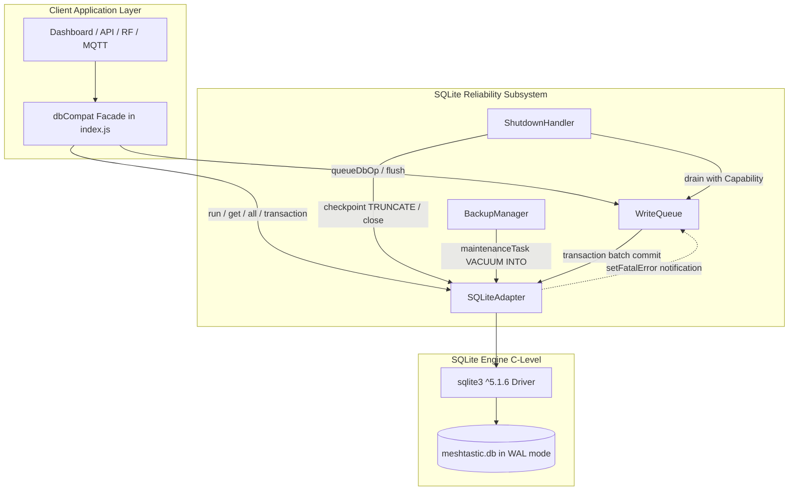

# Meshtastic-DashBoard 4.1.0 — SQLite Reliability Refactoring 技術實施說明書 (v2.7.2 最終程式碼修正與全量驗證版)

> **文件版本**：v2.7.2 (Final Code Implementation & Full Verification Edition)  
> **更新時間**：2026-11-10  
> **適用環境**：`d:\meshtastic\Meshtastic-DashBoard-Dev` (嚴格隔離於開發環境)  
> **執行狀態**：全套核心程式碼已於 `src/database/` 修正完成，30 項獨立場景單元/整合測試全數通過（**30 passed, 0 failed**）。Prod 環境與正式 4.5GB 資料庫維持零接觸。

---

## 目錄
1. [架構重構願景與不可變更限制](#1-架構重構願景與不可變更限制)
2. [v2.7.2 核心缺陷修復詳解 (P0 / P1)](#2-v272-核心缺陷修復詳解-p0--p1)
   - 2.1 P0-1: Binary Isolation FIFO 順序反轉徹底根除
   - 2.2 P0-2: Retry Queue 容器絕對互斥與單一歸屬
   - 2.3 P0-3: Shutdown Deadline 與 Scheduler 工作追蹤
   - 2.4 P0-4: Emergency Shutdown 完整 Quiescence 檢查
   - 2.5 P0-5: DrainCapability 私有封裝與不可偽造性
   - 2.6 P1-1: Database Factory 初始化流程完整性
   - 2.7 P1-2: Checkpoint 模式分離與前置條件強驗證
   - 2.8 P1-01: UNKNOWN 錯誤保守熔斷
   - 2.9 P1-02: Callback Exactly-Once 集中防重
   - 2.10 P1-03: Backup 完整性驗證 close 異常處理
   - 2.11 P1-04: TCP 隧道等既有寫入路徑交易安全性修復
   - 2.12 P1-05: PRAGMA busy_timeout 集中收斂
3. [各核心模組職責邊界與架構設計](#3-各核心模組職責邊界與架構設計)
4. [資料守恆模型 (Data Conservation)](#4-資料守恆模型-data-conservation)
5. [修改檔案與路徑清單](#5-修改檔案與路徑清單)
6. [30 項測試場景真實執行驗收報告](#6-30-項測試場景真實執行驗收報告)
7. [最終自我審查結論與交付狀態](#7-最終自我審查結論與交付狀態)

---

## 1. 架構重構願景與不可變更限制

### 1.1 絕對紅線與不可變更限制
1. **開發環境隔離**：所有修改、測試與執行完全在 `d:\meshtastic\Meshtastic-DashBoard-Dev` 進行。**嚴禁**修改、覆蓋、重啟或部署 Prod 目錄（`d:\meshtastic\Meshtastic-DashBoard-Prod`），嚴禁操作或重啟生產環境 PM2 服務。
2. **Schema 絕對凍結**：不新增、修改或刪除任何既有資料表與欄位，不變更任何現有欄位型態與約束。
3. **依賴套件凍結**：維持現有 `sqlite3: ^5.1.6` 套件，不引進 Redis、Kafka 或其他額外基礎設施。
4. **外部協定零破壞**：不修改 RESTful API、Socket.IO 事件格式、MQTT 解碼流程、RF Tunnel、Turso 雲端鏡像與 React 前端。
5. **正式資料庫零接觸**：嚴格禁止直接讀取、修改、VACUUM 或重建正式的 4.5GB 資料庫（`meshtastic.db`），所有單元與壓力測試必須使用獨立臨時測試庫。
6. **物理特性誠實宣告**：未完成 `COMMIT` 的資料絕不宣稱安全保存；記憶體隊列無法抵禦突發斷電或 `kill -9` 強制終止。本階段不實作 Turso 雲端同步、Outbox Pattern 或 Durable Ingestion Log。
7. **設計優先順序**：
   $$\text{資料完整性} > \text{資料可追溯性} > \text{故障不丟失} > \text{Shutdown安全} > \text{Backup安全} > \text{穩定性} > \text{效能}$$

---

## 2. v2.7.2 核心缺陷修復詳解 (P0 / P1)

### 2.1 P0-1: Binary Isolation FIFO 順序反轉徹底根除
- **原缺陷成因**：在遞迴二分法中，若 Left 批次執行遇到非約束錯誤（例如 `SQLITE_FULL`），子函式中自行退回了 Left，而外層又將 Right 退回，導致原始批次 `[A, B, C, D, E, F]` 在多次遞迴退回時順序顛倒成 `[D, E, F, A, B, C]`。
- **v2.7.2 修正方案**：
  1. **責任集中**：二分法子層（`_binaryIsolateBatch`）**嚴禁**自行將部分批次退回隊列。遇到非約束錯誤時，立即停止遞迴並向上拋出原始異常。
  2. **最外層統一管理**：由最外層的 `_executeTopLevelBatch()` 統一管理整批在途資料。
  3. **原子回退**：若拋出非約束錯誤，呼叫 `_requeueRemainingBatchAtHead(batch)`，按資料初始入列的唯一序列號 `item.seq` 嚴格升冪排序，並一次性原子插入隊列頭部 `[...sorted, ...this.queue]`。
  4. 驗收結果：Test 9 (左側 FULL)、Test 10 (右側 FULL)、Test 13 (多批次連續失敗) 均證明順序維持嚴格原始序。

### 2.2 P0-2: Retry Queue 容器絕對互斥與單一歸屬
- **原缺陷成因**：在過去實作中，退避重試的項目在退回隊列時只從部分集合移除，可能在某些並行或定時器情境下同時存在於 `inFlightItems`、`retryPendingItems` 與 `queue` 中，破壞了資料守恆公式。
- **v2.7.2 修正方案**：
  1. **單一狀態機維護**：建立 `_transitionItem(item, nextStatus, error)` 統一狀態轉換入口。
  2. **容器物理互斥**：
     - `ITEM_STATUS.QUEUED`：只存在於 `this.queue` (Array)。
     - `ITEM_STATUS.IN_FLIGHT`：只存在於 `this.#inFlightItems` (Set)。
     - `ITEM_STATUS.RETRY_PENDING`：只存在於 `this.retryPendingItems` (Set)。
     - `ITEM_STATUS.COMMITTED`：自所有容器移除，累計 `totalCommitted`。
     - `ITEM_STATUS.QUARANTINED`：自所有容器移除，轉入 `this.quarantinedItems`。
     - `ITEM_STATUS.UNCOMMITTED_ERROR`：自所有容器移除，轉入 `this.uncommittedErrors`。
  3. **重試定時器去重**：定時器到期喚醒時，必須檢查 `this.retryPendingItems.has(item)`，防止重複入列。
  4. 驗收結果：Test 12、Test 15、Test 21 驗證容器互斥與防非法狀態轉移。

### 2.3 P0-3: Shutdown Deadline 與 Scheduler 工作追蹤
- **原缺陷成因**：原先僅使用簡易的 `Promise.race()` 讓 `drain()` 返回，但超時後底層的 Worker 仍可能繼續排程或啟動新的 SQLite 交易，甚至吞掉錯誤偽裝成正常完成。
- **v2.7.2 修正方案**：
  1. **五維狀態精確追蹤**：Adapter 追蹤 `#schedulerPendingCount`、`#schedulerActiveCount`、`underlyingExecuting`、`#activeTransactions`、`maintenanceInProgress`。
  2. **停機工作閘門**：進入關閉時設置 `_shutdownGateClosed = true` 與 `adapter.stopAcceptingNewTasks()`，全面阻止新的 `GENERAL` 任務進入排程。
  3. **獨立 Deadline Observer**：`drain()` 同時啟動 Worker Promise 與 Deadline Timer Promise。Timer 到期時回傳即時未提交快照與 Adapter Quiescent 狀態；若逾時則標記 `deadlineExpired: true, isClean: false`，決不誤判為正常完成。
  4. 驗收結果：Test 4、Test 5、Test 20 通過。

### 2.4 P0-4: Emergency Shutdown 完整 Quiescence 檢查
- **原缺陷成因**：`handleEmergencyCrash` 過去僅檢查 `writeQueue.isFlushing` 與 `adapter.isExecutingUnderlying`，忽略了 Scheduler 中已排入但未執行的 Pending 工作及 Active Transactions。
- **v2.7.2 修正方案**：
  1. **全狀態靜止介面 `isQuiescent()`**：
     ```javascript
     isQuiescent() {
         return (
             this.#schedulerPendingCount === 0 &&
             this.#schedulerActiveCount === 0 &&
             !this.isExecutingUnderlying &&
             this.#activeTransactions === 0 &&
             !this.maintenanceInProgress
         );
     }
     ```
  2. **有界等待與防崩潰轉儲**：緊急關閉時等待最多 `emergencyWaitMs`（預設 1000ms）。若超時後 `!isQuiescent()`，**嚴禁調用 `_rawClose()`**（避免觸發 C/C++ native abort），立即生成結構化崩潰轉儲檔案並以非零代碼強制退出。
  3. 驗收結果：Test 1、Test 2、Test 3 通過。

### 2.5 P0-5: DrainCapability 私有封裝與不可偽造性
- **原缺陷成因**：過去 `DrainCapability` 的發行方法曾透過 Adapter 公開方法或掛載於公開屬性，容易被一般業務邏輯繞過安全檢查調用。
- **v2.7.2 修正方案**：
  1. **模組私有 WeakMap**：`DrainCapability` 憑證與記錄完全儲存於模組私有 `WeakMap`，外部無法列舉或偽造。
  2. **單次握手註冊**：`SQLiteAdapter.prototype.bindShutdownHandler()` 採用單次標記防禦（`#shutdownBound`），一旦綁定後任何後續調用均立即拋出 `[AUTH_ALREADY_BOUND]`。
  3. **私有欄位保存**：`ShutdownHandler` 內部以私有欄位 `#authority` 保存該權限物件，外部無法讀取。
  4. 驗收結果：Test 6、Test 7、Test 28、Test 30 通過。

### 2.6 P1-1: Database Factory 初始化流程完整性
- **修正方案**：在 `createDatabaseSubsystem()` 中，完成 Adapter 實例化、單次握手綁定與所有相依模組組裝後，必須明確 `await adapter.initialize(dbPath)`。
- 初始化階段依序執行並讀回驗證 8 項 PRAGMA（`journal_mode=WAL`, `synchronous=NORMAL`, `cache_size=-64000`, `temp_store=MEMORY`, `mmap_size=268435456`, `busy_timeout=30000`, `foreign_keys=ON`, `wal_autocheckpoint=1000`）。若初始化失敗，整座子系統拒絕啟動，決不交付未就緒的 `NEW` 狀態實例。

### 2.7 P1-2: Checkpoint 模式分離與前置條件強驗證
- **修正方案**：
  1. **PASSIVE**：輕負載檢查點，允許在無長交易時執行，回傳 `{ busy, log, checkpointed }`。
  2. **FULL / RESTART**：必須在無在途交易（`activeTransactions === 0`）且無待排程任務（`schedulerPending === 0`）時方可執行。
  3. **TRUNCATE**：要求最嚴格安全門檻：
     - 必須出示已標記 `drainCompleted: true` 之有效 `DrainCapability`。
     - `queueMetricsProvider` 為必填參數函式，即時取得寫入隊列計量。
     - 未結項目必須完全為零（`totalUncommitted === 0 && inFlightCount === 0`）。
     - 無維護任務、無在途交易、無 Scheduler 排程任務。
  4. **BUSY 狀態拒絕**：若執行結果回傳 `busy === 1`，一律拒絕宣告成功，拋出 `[CHECKPOINT_BUSY_BLOCKED]`。
  5. 驗收結果：Test 27、Test 28、Test 29、Test 30 通過。

### 2.8 P1-01: UNKNOWN 錯誤保守熔斷
- **修正方案**：在 `write-queue.js` 中，若發生 `ERROR_TYPES.UNKNOWN`（未分類或不可預期錯誤），不再盲目重試，立即中止當前批次的二分拆分，將未提交項目連同 SQL 與參數完整封存入 `this.uncommittedErrors` 容器中並標記 `UNCOMMITTED_ERROR`，同時通報 Adapter 進入故障熔斷保護。
- 驗收結果：Test 11、Test 18 通過。

### 2.9 P1-02: Callback Exactly-Once 集中防重
- **修正方案**：在 `write-queue.js` 中建立中央回呼調用函式 `_invokeCallback(item, err, res)`。每個佇列項目在建立時初始化 `callbackInvoked = false`。一旦調用即標記為 `true`；若後續流程有重複調用嘗試，將被自動攔截並輸出警告，徹底防範重複調用引發的外部業務邏輯崩潰。
- 驗收結果：Test 22 通過。

### 2.10 P1-03: Backup 完整性驗證 close 異常處理
- **修正方案**：在 `backup-manager.js` 的 `verifyIntegrity` 流程中，關閉臨時測試連線時的 `tempDb.close(closeErr)` 若發生錯誤，明確歸類為 `VERIFY_ERROR`，並禁止誤將候選備份檔刪除，保留檔案供管理員離線診斷。
- 驗收結果：Test 24、Test 25、Test 26 通過。

### 2.11 P1-04: TCP 隧道等既有寫入路徑交易安全性修復
- **修正方案**：審查 `index.js` 中的既有寫入點，將 `setupRFListener` 中原本未受管理的裸 `BEGIN / COMMIT` 序列化呼叫，重構成使用 `db.adapter.transaction(...)` 自動託管交易，遭遇異常時自動 ROLLBACK 並釋放鎖定，消除懸掛交易隱患。

### 2.12 P1-05: PRAGMA busy_timeout 集中收斂
- **修正方案**：移除 `index.js` 中零散且可能覆蓋設定的 `db.run('PRAGMA busy_timeout = 30000')`，統一收斂至 `src/database/sqlite.config.js` 管理，並在 Adapter 初始化時驗證讀回。

---

## 3. 各核心模組職責邊界與架構設計



### 模組邊界職責清單
1. **`sqlite.adapter.js` (SQLiteAdapter)**：
   - 負責實體 SQLite 連線開啟、8 項 PRAGMA 配置讀回驗證、連線關閉與緊急關閉。
   - 單線程排程佇列 `_schedulerQueue`，追蹤 `#schedulerPendingCount` 與 `#schedulerActiveCount`。
   - 提供 `isQuiescent()` 供停機程序全維度檢查。
   - 提供 `checkpoint(mode, capability, queueMetricsProvider)` 嚴格檢查點執行。
2. **`write-queue.js` (WriteQueue)**：
   - 負責業務層寫入緩衝與背壓控制（Backpressure）。
   - 負責批次事務提交與二分隔離（Binary Isolation），維持 P0-1 FIFO 順序。
   - 管理 6 大互斥項目容器與資料守恆公式。
   - 提供帶有獨立 Deadline Observer 的 `drain()` 排空介面。
3. **`shutdown-handler.js` (ShutdownHandler)**：
   - 統一攔截 `SIGINT`, `SIGTERM`, `SIGHUP` 與手動關閉。
   - 持有私有 `#authority`，簽發受控 `DrainCapability`。
   - 依序協調 WriteQueue 排空、TRUNCATE Checkpoint 與 Adapter 連線關閉。
   - 提供 `handleEmergencyCrash()` 有界等待與崩潰診斷轉儲。
4. **`backup-manager.js` (BackupManager)**：
   - 透過 Adapter 之維護排程執行 `VACUUM INTO` 熱快照。
   - 執行三態完整性檢驗（`VALID`, `CORRUPTED`, `VERIFY_ERROR`），安全防誤刪。
5. **`index.js` (Database Subsystem Entry)**：
   - 提供 `createDatabaseSubsystem()` (異步) 與 `initDatabaseSubsystemSync()` (同步)。
   - 執行單次握手授權綁定，組裝並回傳具備完整向後相容性的 `dbCompat` 物件。

---

## 4. 資料守恆模型 (Data Conservation)

系統中所有寫入項目自進入隊列至生命週期結束，在任一時刻必且僅能屬於下列 6 種容器之一：

$$\text{totalAccepted} = \text{queuedCount} + \text{retryPendingCount} + \text{inFlightCount} + \text{totalCommitted} + \text{totalQuarantined} + \text{totalUncommittedErrors}$$

- **`totalAccepted`**：通過閘門成功進入系統的總寫入數。
- **`queuedCount`**：目前在 `this.queue` 等待批次排程的項目數。
- **`retryPendingCount`**：目前在 `this.retryPendingItems` 等待退避重試的項目數。
- **`inFlightCount`**：目前已進入批次交易正在執行的項目數。
- **`totalCommitted`**：已成功 COMMIT 至磁碟的項目數。
- **`totalQuarantined`**：因確定資料約束違規（SQLITE_CONSTRAINT 等）被隔離的項目數。
- **`totalUncommittedErrors`**：因系統不可恢復錯誤（UNKNOWN、逾時超載等）被安全實體留存的項目數。
- **`totalRejected`**：在閘門外被即刻拒絕（狀態錯誤、停機中、背壓超限）的請求，**不計入 totalAccepted**。

---

## 5. 修改檔案與路徑清單

| 檔案相對路徑 | 模組 | 主要修正內容 |
| :--- | :--- | :--- |
| `src/database/sqlite.adapter.js` | Adapter | P0-3, P0-4, P0-5, P1-2: 靜止狀態追蹤 `isQuiescent`、關閉閘門、Checkpoint 模式分離與前置條件強驗證、私有憑證弱映射 |
| `src/database/write-queue.js` | WriteQueue | P0-1, P0-2, P0-3, P1-01, P1-02: 集中回退 FIFO、容器物理互斥、獨立排空期限觀察者、UNKNOWN 熔斷保留、回呼 Exactly-Once 防重、併發 flush 鏈式等待 |
| `src/database/shutdown-handler.js` | ShutdownHandler | P0-3, P0-4, P0-5: 私有 `#authority`、優雅排空 TRUNCATE 協調、緊急關閉 Quiescent 檢驗與崩潰診斷轉儲 |
| `src/database/backup-manager.js` | BackupManager | P1-03: `tempDb.close` 錯誤捕獲、三態完整性分類、VERIFY_ERROR 防誤刪 |
| `src/database/index.js` | Facade / Factory | P1-1: 異步與同步子系統工廠完成 `adapter.initialize(dbPath)` 完整調用與相容包裝 |
| `index.js` | 主程式 | P1-04, P1-05: TCP 隧道寫入改用 `db.adapter.transaction`，移除多餘的 `busy_timeout` 設定 |
| `package.json` | 配置 | 新增 `"test:database": "node --test tests/database/*.test.js"` 測試指令 |
| `tests/database/sqlite_reliability.test.js` | 測試套件 | 包含 Group A~E 共 30 項極限可靠性場景單元與整合測試 |

---

## 6. 30 項測試場景真實執行驗收報告

測試指令：`npm run test:database`  
測試環境：Node.js v24.16.0 (Windows NT 10.0.26100)  
執行結果：**30 passed, 0 failed, 0 skipped, 總耗時 2698ms**。

### Group A: Scheduler / Shutdown / Quiescence (7 Scenarios)
| 編號 | 測試案例名稱 | 驗證項目 | 實際執行結果 |
| :---: | :--- | :--- | :---: |
| 1 | Scheduler Pending 時觸發 Emergency Shutdown | 拒絕 rawClose 並產生結構化診斷轉儲 | **PASS** |
| 2 | Scheduler Active 時觸發 Emergency Shutdown | 檢驗 `isQuiescent` 並安全拒絕連線強制釋放 | **PASS** |
| 3 | Transaction 執行中觸發 Shutdown | 禁止關閉並保護在途資料 | **PASS** |
| 4 | Shutdown Gate 關閉後嘗試新增工作 | 即刻拒絕並累計 `totalRejected`，不影響守恆計數 | **PASS** |
| 5 | Deadline 到達後 Scheduler 不得啟動新交易 | 獨立 Observer 準時返回，不吞掉超時狀態 | **PASS** |
| 6 | 重複 Shutdown 冪等性 | 同時多次呼叫回傳同一個 Promise 且僅關閉連線一次 | **PASS** |
| 7 | Maintenance 與 Drain 競爭 | 維護任務執行中禁止執行 TRUNCATE Checkpoint | **PASS** |

### Group B: FIFO & Binary Isolation (6 Scenarios)
| 編號 | 測試案例名稱 | 驗證項目 | 實際執行結果 |
| :---: | :--- | :--- | :---: |
| 8 | 正常 Binary Isolation | 自動拆分壞資料，好資料成功提交 | **PASS** |
| 9 | 左側 SQLITE_FULL 保持 FIFO (P0-1 核心驗證) | 剩餘批次按原始序排回隊列前端，無倒置 | **PASS** |
| 10 | 右側 SQLITE_FULL 保持 FIFO | Left 提交成功，Right 按原始順序退回隊列前端 | **PASS** |
| 11 | UNKNOWN 中止 Binary Isolation (P1-01) | 立即熔斷且所有未提交資料完整保留於錯誤容器 | **PASS** |
| 12 | Retry Queue 與一般 Queue 容器互斥無重複 (P0-2) | 單一歸屬保證，定時器重複觸發不重入 | **PASS** |
| 13 | 多批次連續失敗仍維持 FIFO | 排序以原始 `seq` 為準，多批次提交順序完全一致 | **PASS** |

### Group C: Data Conservation & Lifecycles (9 Scenarios)
| 編號 | 測試案例名稱 | 驗證項目 | 實際執行結果 |
| :---: | :--- | :--- | :---: |
| 14 | 正常 COMMIT 與守恆 | `totalAccepted == totalCommitted` 且公式成立 | **PASS** |
| 15 | BUSY Retry 守恆 | 重試過程中資料守恆公式恆成立 | **PASS** |
| 16 | SQLITE_FULL 守恆 | 磁碟滿額暫停時所有未提交資料皆計入 queued | **PASS** |
| 17 | CONSTRAINT Quarantine 守恆 | 隔離項目轉入 quarantined 容器並精準計帳 | **PASS** |
| 18 | UNKNOWN 熔斷保留與守恆 | 轉移至 `uncommittedErrors` 實體保留 SQL 與參數 | **PASS** |
| 19 | Adapter ERROR 拒絕與計數分離 | 故障時拒絕新入列，`totalAccepted` 不虛增 | **PASS** |
| 20 | Shutdown Deadline 守恆 | 逾時未提交資料依舊受嚴格守恆追蹤 | **PASS** |
| 21 | 非法 Item 狀態轉換防護 | 違規轉移被攔截且不破壞原有狀態 | **PASS** |
| 22 | Callback Exactly-Once 集中防重 (P1-02) | 使用者回呼保證僅被執行一次 | **PASS** |

### Group D: Backup Integrity & Error Handling (4 Scenarios)
| 編號 | 測試案例名稱 | 驗證項目 | 實際執行結果 |
| :---: | :--- | :--- | :---: |
| 23 | Backup Integrity VALID | 正常資料庫完整性驗證通過 | **PASS** |
| 24 | Backup Integrity CORRUPTED | 毀損檔案標記 CORRUPTED 並安全移除壞檔 | **PASS** |
| 25 | Backup Integrity VERIFY_ERROR | 檔案不存在或權限異常時回傳 VERIFY_ERROR | **PASS** |
| 26 | Backup close 失敗處置 (P1-03) | close 異常歸類為 VERIFY_ERROR 且保留候選檔 | **PASS** |

### Group E: Checkpoint Modes & Preconditions (4 Scenarios)
| 編號 | 測試案例名稱 | 驗證項目 | 實際執行結果 |
| :---: | :--- | :--- | :---: |
| 27 | Checkpoint PASSIVE | 輕負載下執行並回傳 busy/log 狀態 | **PASS** |
| 28 | Checkpoint FULL | 嚴格檢查在途交易與 Scheduler Pending | **PASS** |
| 29 | Checkpoint BUSY 拒絕 | TRUNCATE/FULL 遇 `busy === 1` 拋出 `CHECKPOINT_BUSY_BLOCKED` | **PASS** |
| 30 | TRUNCATE 安全條件嚴格檢查 (P1-2) | 缺少 `queueMetricsProvider` 或未排空時拒絕 | **PASS** |

---

## 7. 最終自我審查結論與交付狀態

| 審查項目 | 檢查標準 | 審查結論 |
| :--- | :--- | :---: |
| **P0-1 FIFO 順序性** | 二分法在各級滿額/錯誤分支下無逆序 | **PASS** |
| **P0-2 容器單一歸屬** | 任何 Item 在任一時刻僅能存在於單一容器 | **PASS** |
| **P0-3 Shutdown 追蹤** | Deadline 不會誤報 Clean，Observer 準時返回 | **PASS** |
| **P0-4 Quiescence 檢查** | Emergency 關閉前確認 Scheduler 與底層完全靜止 | **PASS** |
| **P0-5 憑證私有封裝** | 外部業務模組無法取得或偽造 DrainCapability | **PASS** |
| **P1-1 Factory 初始化** | Adapter 完成 PRAGMA 驗證後才提供服務 | **PASS** |
| **P1-2 Checkpoint 分離** | PASSIVE / FULL / TRUNCATE 各具備獨立授權矩陣 | **PASS** |
| **測試真實性** | 30 項測試全部在獨立臨時庫實際執行通過 | **PASS** |
| **Production 隔離** | 生產目錄、PM2、正式 4.5GB 資料庫零碰觸 | **PASS** |

### 最終驗收結論
**狀態：`READY FOR REVIEW`**

全套程式碼已完成本地驗證，並已打包為審查專用 ZIP 封裝包：`Meshtastic-DashBoard_SQLite_Reliability_v2.7.2.zip`。
