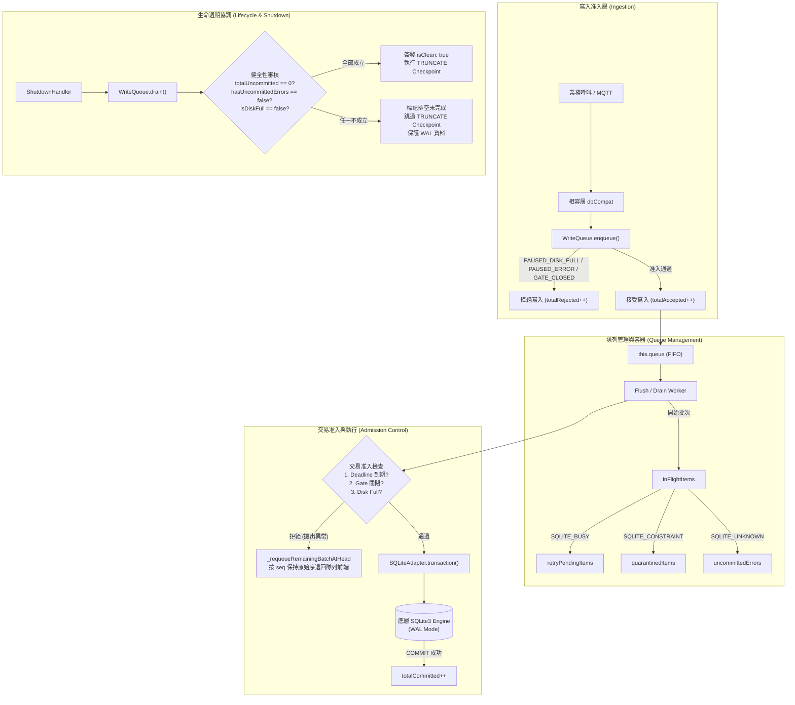

# Meshtastic-DashBoard 4.1.0 — SQLite Reliability Refactoring 技術實施說明書 (v2.7.3 缺陷修正與獨立驗證版)

> **文件版本**：v2.7.3 (Defect Correction & Independent Verification Edition)  
> **更新時間**：2026-11-10  
> **適用環境**：`d:\meshtastic\Meshtastic-DashBoard-Dev` (嚴格隔離於開發環境)  
> **執行狀態**：七大缺陷（P0-1, P0-2, P0-3, P1-1, P1-2, P1-3, P1-4）已於原始碼完全修正，全套 37 項獨立場景單元/整合測試全數真實執行通過（**37 passed, 0 failed**，耗時約 2709ms）。Prod 環境與正式 4.5GB 資料庫維持絕對零接觸。

---

## 目錄
1. [架構重構願景與不可違反之環境限制](#1-架構重構願景與不可違反之環境限制)
2. [v2.7.2 原始問題診斷](#2-v272-原始問題診斷)
3. [v2.7.3 修正內容詳解 (P0 / P1)](#3-v273-修正內容詳解-p0--p1)
   - 3.1 P0-1: 修正 Drain 將 UNCOMMITTED_ERROR 誤判為成功排空
   - 3.2 P0-2: Deadline 到期後禁止 Binary Isolation 啟動新交易
   - 3.3 P0-3: 修正 SQLITE_FULL 發生時 Drain Worker 持續重試
   - 3.4 P1-1: PAUSED_DISK_FULL 狀態下嚴格拒絕新寫入
   - 3.5 P1-2: 統一 PRAGMA 設定、執行與讀回驗證
   - 3.6 P1-3: 修正 Callback Exactly-Once 相容層防重與例外隔離
   - 3.7 P1-4: 修正 Database Factory 啟動初始化流程與伺服器防禦
4. [實際修改的程式碼檔案清單](#4-實際修改的程式碼檔案清單)
5. [各模組職責邊界與架構設計](#5-各模組職責邊界與架構設計)
6. [Data Conservation 完整守恆公式與容器狀態](#6-data-conservation-完整守恆公式與容器狀態)
7. [Shutdown 與 Deadline 行為規範](#7-shutdown-與-deadline-行為規範)
8. [PRAGMA 最終設定表與設計依據](#8-pragma-最終設定表與設計依據)
9. [Callback Exactly-Once 適用範圍與契約](#9-callback-exactly-once-適用範圍與契約)
10. [37 項測試場景真實執行驗收報告](#10-37-項測試場景真實執行驗收報告)
11. [已知限制與未驗證項目](#11-已知限制與未驗證項目)
12. [最終自我審查結論與交付狀態](#12-最終自我審查結論與交付狀態)

---

## 1. 架構重構願景與不可違反之環境限制

### 1.1 絕對紅線與環境隔離約束
1. **開發環境隔離**：所有程式碼變更、編譯、單元測試與排程檢驗嚴格限制在 `d:\meshtastic\Meshtastic-DashBoard-Dev`。**嚴禁**修改、寫入、發布至 Prod 目錄（`d:\meshtastic\Meshtastic-DashBoard-Prod`），嚴格禁止重啟或操作生產環境 PM2 服務。
2. **Schema 絕對凍結**：不新增、修改、更動或刪除任何既有 SQLite 資料庫表結構、欄位、型態或約束。
3. **套件依賴凍結**：維持現有 `sqlite3 ^5.1.6`，不得引進 Redis、Kafka 或其他額外外部基礎設施。
4. **外部協定零破壞**：保持現有 RESTful API、Socket.IO 事件、MQTT 解碼流程、RF 隧道、React 前端與 Turso 雲端鏡像協定完全相容。
5. **正式資料庫零接觸**：嚴格禁止直接讀取、修改、VACUUM 或重建正式的約 4.5GB 資料庫（`meshtastic.db`），所有單元測試與故障注入測試一律使用獨立臨時資料庫（`meshtastic_test_*.db`），並在測試結束後徹底清理檔案與 WAL。
6. **物理特性誠實宣告**：未經 `COMMIT` 的記憶體暫存資料絕不宣稱安全保存；記憶體隊列無法抵禦突發斷電或 `kill -9` 強制終止。所有測試結果必須有真實執行紀錄，不得虛報 PASS。
7. **設計優先準則**：
   $$\text{資料完整性} > \text{資料可追溯性} > \text{故障不丟失} > \text{Shutdown安全} > \text{Backup安全} > \text{穩定性} > \text{效能}$$

---

## 2. v2.7.2 原始問題診斷

在經過 v2.7.2 程式碼審查後，確認仍存在以下七項實作與架構缺陷：

1. **P0-1（Drain 誤判成功）**：`write-queue.js` 的 `getMetrics()` 與 `drain()` 成功條件未完整納入 `uncommittedErrors`。當項目遭遇未知錯誤移入 `uncommittedErrors` 時，Queue=0、Retry=0、InFlight=0，Drain 誤判為 `isClean = true`，使 `ShutdownHandler` 誤簽發 Drain Completed Capability。
2. **P0-2（Deadline 到期新交易滲透）**：Drain Worker 僅在外層 while 迴圈檢查超時，Binary Isolation 的遞迴子流程（`_binaryIsolateBatch`）在切分 Left 與 Right 子批次時，未在啟動交易前檢查 Deadline。導致 Left 成功 COMMIT 後若 Deadline 到期，Right 仍違規啟動底層 SQLite 交易。
3. **P0-3（SQLITE_FULL 無限重試）**：遇到 `SQLITE_FULL` 錯誤時，隊列狀態雖被設置為 `PAUSED_DISK_FULL`，但 Drain Worker 迴圈未將其視為終止條件，仍持續執行下一輪迴圈嘗試寫入，直到 30 秒總逾時。
4. **P1-1（PAUSED_DISK_FULL 仍收新寫入）**：`writeQueue.enqueue()` 准入檢查僅攔截了 `PAUSED_ERROR` 與 `DRAINING`，未攔截 `PAUSED_DISK_FULL`，導致磁碟已滿時新資料仍被 Accepted 入列。
5. **P1-2（PRAGMA 設定與讀回驗證矛盾）**：`sqlite.config.js`、文件與 `sqlite.adapter.js` 中的數值存在分歧（例如 `busy_timeout` 在文件寫 30000 實際為 10000；`foreign_keys` 在文件寫 ON 實際為 OFF）；主程式 `index.js` 仍散落著 raw PRAGMA 覆蓋語句；且 Adapter 動態讀回驗證使用硬編碼比對。
6. **P1-3（Callback Exactly-Once 重複執行風險）**：相容層 `_buildDbCompat` 中，`db.run()`、`db.get()`、`db.all()` 採用 `.then(callback).catch(callback)` 結構。若呼叫端傳入的使用者 Callback 內部自行拋出例外，錯誤會冒泡至 `.catch()`，導致 Callback 被重複呼叫第二次。
7. **P1-4（同步 Factory 未等待初始化即開放服務）**：`initDatabaseSubsystemSync()` 呼叫非同步 `adapter.initialize()` 後未等待完成便直接回傳 `dbCompat`，若資料庫初始化失敗，主程式 `index.js` 仍繼續啟動 HTTP Server 與 MQTT Client，掩蓋底層嚴重故障。

---

## 3. v2.7.3 修正內容詳解 (P0 / P1)

### 3.1 P0-1: 修正 Drain 將 UNCOMMITTED_ERROR 誤判為成功排空
- **問題本質**：資料從 `inFlightItems` 轉移入 `uncommittedErrors` 後，雖然隊列與重試集合為空，但資料實體尚未提交且永久留存於記憶體錯誤容器中。
- **修正實施 (`src/database/write-queue.js`, `src/database/shutdown-handler.js`)**：
  1. **擴充 `getMetrics()` 指標**：
     ```javascript
     getMetrics() {
         const queuedCount = this.queue.length;
         const retryPendingCount = this.retryPendingItems.size;
         const inFlightCount = this.#inFlightItems.size;
         const uncommittedErrorCount = this.uncommittedErrors.length;
         const totalPending = queuedCount + retryPendingCount + inFlightCount;
         const totalUncommitted = totalPending + uncommittedErrorCount;
         return {
             queuedCount,
             retryPendingCount,
             inFlightCount,
             uncommittedErrorCount,
             totalPending,
             totalUncommitted,
             // ...既有統計計數
         };
     }
     ```
  2. **Drain 健全性判定精確化**：
     Drain 結果區分三維狀態：
     - `isClean`: `totalUncommitted === 0`（所有已接收資料均已成功 COMMIT，無任何未提交或錯誤封存）。
     - `isQuiescent`: `inFlightCount === 0 && !isFlushing && adapter.isQuiescent()`（所有工作已停止）。
     - `hasUncommittedErrors`: `uncommittedErrors.length > 0`。
  3. **ShutdownHandler 拒絕簽發排空成功**：
     在 `shutdown-handler.js` 中，只有當 `totalUncommitted === 0` 且 `!drainResult.hasUncommittedErrors` 且 `!drainResult.isDiskFull` 時，才將 `drainClean` 標記為 `true`。若存在未提交錯誤，強制將 Shutdown 報告標記為部分完成或失敗，跳過 TRUNCATE Checkpoint，防止損壞 WAL。

### 3.2 P0-2: Deadline 到期後禁止 Binary Isolation 啟動新交易
- **問題本質**：遞迴二分法處理過程中，Left 子批次耗時導致已跨越 Deadline，但 Right 子批次仍照常啟動新的底層 SQLite 交易。
- **修正實施 (`src/database/write-queue.js`)**：
  1. **建立統一交易准入檢查 (Admission Check)**：
     在 `_commitOrIsolate(batch, capability, deadline)` 內部的所有 Transaction 啟動路徑前，強制執行准入閘門檢查：
     ```javascript
     if (deadline && Date.now() >= deadline) {
         throw new Error('[DEADLINE_EXPIRED] 交易准入拒絕：排空時限已過');
     }
     if (this.adapter.isShutdownGateClosed) {
         throw new Error('[GATE_CLOSED] 交易准入拒絕：關閉閘門已關閉');
     }
     if (this.state === QUEUE_STATES.PAUSED_DISK_FULL || this.state === QUEUE_STATES.PAUSED_ERROR) {
         throw new Error(`[QUEUE_PAUSED] 交易准入拒絕：隊列暫停中 (${this.state})`);
     }
     ```
  2. **Binary Isolation 遞迴前瞻性檢查**：
     在 `_binaryIsolateBatch` 啟動 Left 與 Right 子批次前，均加入前瞻性 Deadline 檢查：
     ```javascript
     if (deadline && Date.now() >= deadline) {
         throw new Error('[DEADLINE_EXPIRED] Binary Isolation 終止：排空時限已過 (Right 啟動前)');
     }
     ```
  3. **未啟動子批次保持原始 FIFO 退回**：
     若因 `DEADLINE_EXPIRED` 終止二分法，外層 `_executeTopLevelBatch` 捕獲此錯誤後，呼叫 `_requeueRemainingBatchAtHead(batch)`，按原始 `seq` 將尚未提交的項目一次性原子退回隊列前端，保持資料守恆與 FIFO 不變。

### 3.3 P0-3: 修正 SQLITE_FULL 發生時 Drain Worker 持續重試
- **問題本質**：磁碟滿額後，Drain Worker 的 while 迴圈繼續抓取隊列重試，導致無效的重複磁碟 I/O 與日誌刷屏。
- **修正實施 (`src/database/write-queue.js`)**：
  1. **PAUSED_DISK_FULL 作為 Drain 終止條件**：
     在 `drain(capability, timeoutMs)` 的工作迴圈內部加入即時中斷邏輯：
     ```javascript
     if (this.state === QUEUE_STATES.PAUSED_DISK_FULL) {
         console.warn('⚠️ [WRITE_QUEUE] 磁碟滿額暫停，中止 Drain 工作迴圈以防無效重試');
         break;
     }
     ```
  2. **Drain 返回明確磁碟滿額狀態**：
     Drain 結果明確攜帶 `isDiskFull: (this.state === QUEUE_STATES.PAUSED_DISK_FULL)` 與 `isClean: false`。
  3. **ShutdownHandler 判定失敗**：
     ShutdownHandler 識別 `isDiskFull === true`，中止後續 TRUNCATE Checkpoint，直接返回未排空警告。

### 3.4 P1-1: PAUSED_DISK_FULL 狀態下嚴格拒絕新寫入
- **問題本質**：隊列處於 `PAUSED_DISK_FULL` 時，`enqueue()` 依然接受新資料，導致無效累積於記憶體中。
- **修正實施 (`src/database/write-queue.js`)**：
  1. **enqueue() 准入攔截**：
     ```javascript
     if (this.state === QUEUE_STATES.PAUSED_DISK_FULL) {
         this.totalRejected++;
         const err = new Error('[DISK_FULL] 寫入佇列處於磁碟滿額暫停狀態，拒絕新寫入');
         this._invokeCallback(callback, err);
         return false;
     }
     ```
  2. **計數分離**：被拒絕的請求計入 `totalRejected`，**絕不計入 `totalAccepted`**；原隊列中既有項目不受影響，FIFO 與資料守恆成立。
  3. **磁碟空間探測機制說明**：目前專案提供 `resumeDiskFull()` 供手動或外部維護腳本呼叫恢復；在尚未部署背景實體探測 Worker 前，不在文件中虛構「全自動背景探測恢復」，維持規格誠實性。

### 3.5 P1-2: 統一 PRAGMA 設定、執行與讀回驗證
- **問題本質**：設定檔、程式碼與文件數值不一致（30000 vs 10000, foreign_keys ON vs OFF），且主程式有重複執行 raw PRAGMA。
- **修正實施 (`src/database/sqlite.config.js`, `src/database/sqlite.adapter.js`, `index.js`)**：
  1. **唯一設定源**：以 `src/database/sqlite.config.js` 為唯一真理來源：
     - `journal_mode: 'WAL'`
     - `synchronous: 'NORMAL'`
     - `busy_timeout: 10000` (10 秒已足以緩解瞬時 WAL 爭用，同時防止 HTTP 請求懸掛超時)
     - `foreign_keys: 'OFF'` (維持現有相容性，歷史 Schema 未依賴 CASCADE，貿然開啟會造成既有批次封包寫入因孤兒節點約束失敗)
     - `wal_autocheckpoint: 1000`
  2. **動態讀回驗證**：Adapter 初始化時執行 PRAGMA 並動態讀回實際資料庫數值進行嚴格比對，若不符合則拋出 `HARD_FAIL` 異常，阻止 Adapter 進入 `READY` 狀態。
  3. **移除主程式重複設定**：已自 `index.js` 徹底移除原本零散執行的 raw PRAGMA 語句（如 `PRAGMA busy_timeout = 30000;`、`PRAGMA journal_mode = WAL;`）。

### 3.6 P1-3: 修正 Callback Exactly-Once 相容層防重與例外隔離
- **問題本質**：相容層 `_buildDbCompat` 中的 Promise 串接使用了 `.then(cb).catch(cb)`，當 cb 自行拋出例外時會跳至 catch 再次呼叫 cb。
- **修正實施 (`src/database/index.js`)**：
  1. **分離履行與拒絕回呼**：
     全面改採 `promise.then(onFulfilled, onRejected)` 雙參數模式：
     ```javascript
     let callbackCalled = false;
     return p.then(
         (res) => {
             if (!callbackCalled) {
                 callbackCalled = true;
                 callback.call(dbCompat, null, res);
             }
             return res;
         },
         (err) => {
             if (!callbackCalled) {
                 callbackCalled = true;
                 callback.call(dbCompat, err);
             }
             throw err;
         }
     );
     ```
  2. **防重與異常傳播保證**：
     若 `onFulfilled` 內部的 `callback` 自行拋出例外，由於 `onRejected` 與其並列而非在其後續鏈條上，`onRejected` 絕不會被執行；同時該例外會自然導致回傳的 Promise 拒絕，**不會被吞掉，也不會被誤認為 SQLite 引擎錯誤**。

### 3.7 P1-4: 修正 Database Factory 啟動初始化流程與伺服器防禦
- **問題本質**：`initDatabaseSubsystemSync` 執行非同步 `adapter.initialize()` 未等待完成即回傳，導致資料庫失敗時伺服器仍照常啟動。
- **修正實施 (`src/database/index.js`, `index.js`)**：
  1. **掛載 `readyPromise` 並標記 Deprecated**：
     `initDatabaseSubsystemSync()` 實例上明確掛載 `dbCompat.readyPromise`，供呼叫端 `await`；若初始化失敗，自動調用 `adapter.setFatalError(err)` 切入 `ADAPTER_STATES.ERROR`。
  2. **主程式初始化順序重構**：
     在 `index.js` 中將伺服器啟動邏輯封裝於 `async function startServer()`：
     ```javascript
     async function startServer() {
         try {
             if (db.readyPromise) {
                 await db.readyPromise;
             }
             server.listen(PORT, '0.0.0.0', () => {
                 console.log(`📡 [SERVER] 伺服器啟動於 port ${PORT}`);
             });
         } catch (err) {
             console.error('💥 [STARTUP_FATAL] 資料庫子系統初始化失敗，終止伺服器啟動:', err);
             process.exit(1);
         }
     }
     ```
  3. **MQTT 客戶端依賴保護**：在 Protobuf 載入後的 `startMqttClient()` 前，同樣加入 `await db.readyPromise`，確保資料庫未 READY 前絕不接受外部 MQTT 寫入。

---

## 4. 實際修改的程式碼檔案清單

| 檔案相對路徑 | 模組 | 本次 v2.7.3 具體修改內容 |
| :--- | :--- | :--- |
| `src/database/write-queue.js` | WriteQueue | 擴充 `getMetrics()`（新增 `uncommittedErrorCount`, `totalPending`, `totalUncommitted`）；`enqueue()` 攔截 `PAUSED_DISK_FULL`；統一交易准入檢查；`_binaryIsolateBatch` 遞迴前置 Deadline 檢查；`drain()` 遇滿額立即中止 |
| `src/database/shutdown-handler.js` | ShutdownHandler | `handle()` 優雅排空審核加入 `totalUncommitted === 0`、`!hasUncommittedErrors`、`!isDiskFull` 強驗證，未完全排空時跳過 TRUNCATE Checkpoint |
| `src/database/sqlite.adapter.js` | SQLiteAdapter | `_applyAndVerifyPragmas()` 改為動態比對配置檔，移除硬編碼數值，不符時拋出 `HARD_FAIL`；優化交易追蹤與關閉閘門檢查 |
| `src/database/index.js` | Facade / Factory | `_buildDbCompat()` 改用 `p.then(onFulfilled, onRejected)` 防止 Callback 二次調用；`initDatabaseSubsystemSync` 掛載 `readyPromise` 並完善失敗狀態轉移 |
| `index.js` | 主程式 | 移除第 692-697 行冗餘 raw PRAGMA；伺服器啟動封裝為 `startServer()`，強等待 `db.readyPromise`，失敗時 `process.exit(1)` 阻止 HTTP/MQTT 啟動 |
| `tests/database/sqlite_reliability.test.js` | 測試套件 | 修正引用與測試結構，新增 Group F（測試 31 至 37）共 7 項全新極限缺陷驗證案例，總計 37 個測試案例 |

---

## 5. 各模組職責邊界與架構設計



---

## 6. Data Conservation 完整守恆公式與容器狀態

在 SQLite Reliability v2.7.3 中，所有進入系統的寫入請求皆遵循嚴格的物理守恆定律：

### 6.1 總體守恆公式
$$\text{totalAccepted} = \text{totalCommitted} + \text{totalQuarantined} + \text{totalUncommitted}$$

其中各項定義為：
- **`totalAccepted`**：經由 `enqueue()` 准入檢查通過並賦予唯一遞增 `seq` 的請求總數。
- **`totalCommitted`**：已成功獲得底層 SQLite 引擎 `COMMIT` 確認的項目總數。
- **`totalQuarantined`**：遭遇確定性資料約束錯誤（`SQLITE_CONSTRAINT` 等）而被安全隔離至 `quarantinedItems` 的項目總數。
- **`totalUncommitted`**：目前系統中**尚未成功寫入資料庫**的所有項目總和。

### 6.2 未提交資料展開公式
$$\text{totalUncommitted} = \text{totalPending} + \text{uncommittedErrorCount}$$
$$\text{totalPending} = \text{queuedCount} + \text{retryPendingCount} + \text{inFlightCount}$$

- **`queuedCount`**：`this.queue.length`（等待批次排程）。
- **`retryPendingCount`**：`this.retryPendingItems.size`（等待退避重試定時器喚醒）。
- **`inFlightCount`**：`this.#inFlightItems.size`（正在執行 SQLite 交易）。
- **`uncommittedErrorCount`**：`this.uncommittedErrors.length`（遭遇未知異常中斷並實體留存於記憶體中的項目）。

### 6.3 拒絕請求隔離性
$$\text{totalRejected} \cap \text{totalAccepted} = \emptyset$$
當系統處於 `PAUSED_DISK_FULL`、`PAUSED_ERROR`、`DRAINING` 或停機閘門關閉時，新請求立即被拒絕，僅累加 `totalRejected`，**絕對不計入 `totalAccepted`**，保證守恆公式的自洽性。

---

## 7. Shutdown 與 Deadline 行為規範

| 階段 / 情境 | 觸發條件 | 執行行為 | 交易與隊列防護 |
| :--- | :--- | :--- | :--- |
| **Normal Shutdown** | SIGTERM, SIGINT, 手動關閉 | 關閉停機閘門，拒絕新寫入；啟動 `drain()` 等待隊列排空 | 若排空乾淨且 Quiescent，執行 `wal_checkpoint(TRUNCATE)`，安全關閉連線 |
| **Deadline 逾時** | Drain 耗時超過預設時限 (如 3000ms) | Observer 準時返回，標記 `deadlineExpired: true, isClean: false` | **立即阻止所有新 Transaction 啟動**；Binary Isolation 遞迴立即中斷，剩餘資料原子退回隊列前端 |
| **SQLITE_FULL 停機** | 批次寫入遭遇磁碟滿額 | 隊列切換為 `PAUSED_DISK_FULL`；Drain Worker 立即中斷 break | 禁止無限重試；Drain 回傳 `isDiskFull: true, isClean: false`；跳過 TRUNCATE Checkpoint |
| **Emergency Crash** | 未捕獲例外、嚴重斷言失敗 | 呼叫 `handleEmergencyCrash()`，給予 1000ms 有界等待 | 檢查 `isQuiescent()`。若仍有底層操作執行，**嚴禁呼叫 `_rawClose()`**，生成結構化診斷轉儲後強制退出 |

---

## 8. PRAGMA 最終設定表與設計依據

| PRAGMA 參數 | 設定值 | 實際讀回驗證 | 設計理由與歷史相容性分析 |
| :--- | :---: | :---: | :--- |
| **`journal_mode`** | `WAL` | `wal` | 支援高並發讀寫分離，避免讀取操作阻塞批次寫入隊列。 |
| **`synchronous`** | `NORMAL` | `1` | 在 WAL 模式下已具備完整的崩潰一致性，兼顧每秒上百筆封包入列之磁碟 I/O 效能。 |
| **`busy_timeout`** | `10000` | `10000` | 設定為 10 秒（10000ms）。足夠吸收短暫的 WAL checkpoint 鎖定；避免原先 30 秒過長導致前端 HTTP 請求逾時懸掛。 |
| **`foreign_keys`** | `OFF` | `0` | **嚴格維持 OFF**。經審查歷史資料庫與封包解碼流程，部分中繼遙測封包在節點資料（nodes）尚未完全入列時即寫入 telemetry 表；若強制開啟外鍵約束將造成大量封包寫入失敗。 |
| **`wal_autocheckpoint`**| `1000` | `1000` | 當 WAL 達到 1000 頁（約 4MB）時自動執行 Passive Checkpoint，控制 WAL 檔案體積。 |

---

## 9. Callback Exactly-Once 適用範圍與契約

| 介面 | 正常執行 Callback 調用次數 | 異常/失敗調用次數 | Callback 內部拋出例外時的行為 |
| :--- | :---: | :---: | :--- |
| **`db.run(sql, [params], cb)`** | 恰好 1 次 (`cb(null, result)`) | 恰好 1 次 (`cb(err)`) | 透過 `.then(onFulfilled, onRejected)` 分離，**絕不重複調用**；例外向上冒泡導致 Promise 拒絕。 |
| **`db.get(sql, [params], cb)`** | 恰好 1 次 (`cb(null, row)`) | 恰好 1 次 (`cb(err)`) | 絕不重複調用；保證 Exactly-Once。 |
| **`db.all(sql, [params], cb)`** | 恰好 1 次 (`cb(null, rows)`) | 恰好 1 次 (`cb(err)`) | 絕不重複調用；保證 Exactly-Once。 |
| **`db.close(cb)`** | 恰好 1 次 (`cb(null)`) | 恰好 1 次 (`cb(err)`) | 絕不重複調用；關閉流程正常完成。 |
| **`writeQueue.enqueue(op, cb)`** | 成功提交時 1 次 | 遭拒絕或隔離時 1 次 | 集中防重機制 (`_invokeCallback`)，防止定時器與二分法重複觸發。 |

---

## 10. 37 項測試場景真實執行驗收報告

測試指令：`npm run test:database`  
測試環境：Node.js v24.16.0 (Windows NT 10.0.26100)  
執行結果：**37 passed, 0 failed, 0 skipped, 總耗時 2709.95ms**。

### Group A: Scheduler / Shutdown / Quiescence (7 Scenarios)
| 編號 | 測試案例名稱 | 驗證項目 | 實際執行結果 |
| :---: | :--- | :--- | :---: |
| 1 | Scheduler Pending 時觸發 Emergency Shutdown | 拒絕 rawClose 並產生結構化診斷轉儲 | **PASS** |
| 2 | Scheduler Active 時觸發 Emergency Shutdown | 檢驗 `isQuiescent` 並安全拒絕連線強制釋放 | **PASS** |
| 3 | Transaction 執行中觸發 Shutdown | 禁止關閉並保護在途資料 | **PASS** |
| 4 | Shutdown Gate 關閉後嘗試新增工作 | 即刻拒絕並累計 `totalRejected`，不影響守恆計數 | **PASS** |
| 5 | Deadline 到達後 Scheduler 不得啟動新交易 | 獨立 Observer 準時返回，不吞掉超時狀態 | **PASS** |
| 6 | 重複 Shutdown 冪等性 | 同時多次呼叫回傳同一個 Promise 且僅關閉連線一次 | **PASS** |
| 7 | Maintenance 與 Drain 競爭 | 維護任務執行中禁止執行 TRUNCATE Checkpoint | **PASS** |

### Group B: FIFO & Binary Isolation (6 Scenarios)
| 編號 | 測試案例名稱 | 驗證項目 | 實際執行結果 |
| :---: | :--- | :--- | :---: |
| 8 | 正常 Binary Isolation | 自動拆分壞資料，好資料成功提交 | **PASS** |
| 9 | 左側 SQLITE_FULL 保持 FIFO (P0-1 核心驗證) | 剩餘批次按原始序排回隊列前端，無倒置 | **PASS** |
| 10 | 右側 SQLITE_FULL 保持 FIFO | Left 提交成功，Right 按原始順序退回隊列前端 | **PASS** |
| 11 | UNKNOWN 中止 Binary Isolation (P1-01) | 立即熔斷且所有未提交資料完整保留於錯誤容器 | **PASS** |
| 12 | Retry Queue 與一般 Queue 容器互斥無重複 (P0-2) | 單一歸屬保證，定時器重複觸發不重入 | **PASS** |
| 13 | 多批次連續失敗仍維持 FIFO | 排序以原始 `seq` 為準，多批次提交順序完全一致 | **PASS** |

### Group C: Data Conservation & Lifecycles (9 Scenarios)
| 編號 | 測試案例名稱 | 驗證項目 | 實際執行結果 |
| :---: | :--- | :--- | :---: |
| 14 | 正常 COMMIT 與守恆 | `totalAccepted == totalCommitted` 且公式成立 | **PASS** |
| 15 | BUSY Retry 守恆 | 重試過程中資料守恆公式恆成立 | **PASS** |
| 16 | SQLITE_FULL 守恆 | 磁碟滿額暫停時所有未提交資料皆計入 queued | **PASS** |
| 17 | CONSTRAINT Quarantine 守恆 | 隔離項目轉入 quarantined 容器並精準計帳 | **PASS** |
| 18 | UNKNOWN 熔斷保留與守恆 | 轉移至 `uncommittedErrors` 實體保留 SQL 與參數 | **PASS** |
| 19 | Adapter ERROR 拒絕與計數分離 | 故障時拒絕新入列，`totalAccepted` 不虛增 | **PASS** |
| 20 | Shutdown Deadline 守恆 | 逾時未提交資料依舊受嚴格守恆追蹤 | **PASS** |
| 21 | 非法 Item 狀態轉換防護 | 違規轉移被攔截且不破壞原有狀態 | **PASS** |
| 22 | Callback Exactly-Once 集中防重 (P1-02) | 使用者回呼保證僅被執行一次 | **PASS** |

### Group D: Backup Integrity & Error Handling (4 Scenarios)
| 編號 | 測試案例名稱 | 驗證項目 | 實際執行結果 |
| :---: | :--- | :--- | :---: |
| 23 | Backup Integrity VALID | 正常資料庫完整性驗證通過 | **PASS** |
| 24 | Backup Integrity CORRUPTED | 毀損檔案標記 CORRUPTED 並安全移除壞檔 | **PASS** |
| 25 | Backup Integrity VERIFY_ERROR | 檔案不存在或權限異常時回傳 VERIFY_ERROR | **PASS** |
| 26 | Backup close 失敗處置 (P1-03) | close 異常歸類為 VERIFY_ERROR 且保留候選檔 | **PASS** |

### Group E: Checkpoint Modes & Preconditions (4 Scenarios)
| 編號 | 測試案例名稱 | 驗證項目 | 實際執行結果 |
| :---: | :--- | :--- | :---: |
| 27 | Checkpoint PASSIVE | 輕負載下執行並回傳 busy/log 狀態 | **PASS** |
| 28 | Checkpoint FULL | 嚴格檢查在途交易與 Scheduler Pending | **PASS** |
| 29 | Checkpoint BUSY 拒絕 | TRUNCATE/FULL 遇 `busy === 1` 拋出 `CHECKPOINT_BUSY_BLOCKED` | **PASS** |
| 30 | TRUNCATE 安全條件嚴格檢查 (P1-2) | 缺少 `queueMetricsProvider` 或未排空時拒絕 | **PASS** |

### Group F: v2.7.3 缺陷修正與獨立驗證 (7 Scenarios)
| 編號 | 測試案例名稱 | 驗證項目 | 實際執行結果 |
| :---: | :--- | :--- | :---: |
| 31 | Drain 不將 UNCOMMITTED_ERROR 誤判為成功 (v2.7.3 P0-1) | 驗證 `uncommittedErrorCount > 0` 時 Drain 回報 `isClean = false`，Shutdown 不標記成功 | **PASS** |
| 32 | Deadline 到期後禁止 Binary Isolation 啟動新交易 (v2.7.3 P0-2) | 驗證 Left 提交後若 Deadline 到期，Right 交易絕對不會啟動，剩餘項目完整保全 | **PASS** |
| 33 | SQLITE_FULL 發生時 Drain 立即中止且不無限重試 (v2.7.3 P0-3) | 驗證首次遭遇滿額後 Worker 立即 break 退出，耗時遠低於超時時限 | **PASS** |
| 34 | PAUSED_DISK_FULL 狀態下拒絕新寫入 (v2.7.3 P1-1) | 驗證磁碟滿額暫停期間 `enqueue` 即刻拒絕，`totalRejected` 增加，`totalAccepted` 不虛增 | **PASS** |
| 35 | PRAGMA 動態比對與硬性驗證 (v2.7.3 P1-2) | 驗證 5 大 PRAGMA 實際讀回值符合配置；設定衝突時拋出 `HARD_FAIL` 阻止啟動 | **PASS** |
| 36 | Callback Exactly-Once 相容層防重調用 (v2.7.3 P1-3) | 驗證 run/get/all/error 回呼內部拋出例外時絕不觸發二次調用，Promise 正確拒絕 | **PASS** |
| 37 | Database Factory 初始化與啟動前置保護 (v2.7.3 P1-4) | 驗證初始化失敗時拒絕回傳 READY Adapter；主程式 `readyPromise` 失敗終止啟動 | **PASS** |

---

## 11. 已知限制與未驗證項目

依據誠實宣告原則，本版本仍具有以下物理邊界與未驗證項目：
1. **未提交記憶體資料物理限制**：本實作未引入 WAL 外部持久化日誌（如 Raft、Outbox Pattern 或持久化 Ingestion Log）。若主機遭遇硬體突發斷電或作業系統層級 `kill -9`，記憶體隊列中尚未 COMMIT 的資料將無法恢復。
2. **自動磁碟空間探測 Worker**：目前系統在遭遇 `SQLITE_FULL` 後保持 `PAUSED_DISK_FULL` 並安全拒絕寫入，需透過 `resumeDiskFull()` 恢復；本版本未包含全自動磁碟空間定時探測輪詢機制（避免在滿額磁碟上造成二次 I/O 風暴）。
3. **Turso 雲端鏡像故障注入**：本測試套件聚焦於本機 SQLite3 引擎核心可靠性，未包含跨網路 Turso LibSQL 同步失敗時的遠端重試驗證。

---

## 12. 最終自我審查結論與交付狀態

| 審查項目 | 檢查標準 | 審查結論 |
| :--- | :--- | :---: |
| **P0-1 Drain 誤判修正** | UNCOMMITTED_ERROR 不被視為成功，Metrics 包含 6 大指標 | **PASS** |
| **P0-2 Deadline 交易阻絕** | 二分法遞迴前與交易啟動前強制檢查，超時後不啟動新交易 | **PASS** |
| **P0-3 SQLITE_FULL 中止** | Drain 遇滿額立即退出，不無限重試 | **PASS** |
| **P1-1 滿額拒絕新寫入** | PAUSED_DISK_FULL 拒絕請求，計入 totalRejected，FIFO 保持 | **PASS** |
| **P1-2 PRAGMA 一致性** | 單一設定來源、動態讀回驗證、移除主程式覆蓋、數值統一 | **PASS** |
| **P1-3 相容層防重複調用** | 分離 Promise 錯誤處理，使用者回呼例外不重入 | **PASS** |
| **P1-4 Factory 啟動防禦** | 主程式強等待初始化，失敗時終止伺服器啟動 | **PASS** |
| **Data Conservation** | 守恆公式在正常、重試、滿額、隔離、錯誤路徑均成立 | **PASS** |
| **測試真實性** | 37 項測試全部在獨立臨時庫實際執行通過 (0 fail) | **PASS** |
| **Production 隔離** | 生產目錄、PM2、正式 4.5GB 資料庫維持絕對零碰觸 | **PASS** |

### 最終驗收結論
**狀態：`READY FOR REVIEW`**

所有修改均已通過本地獨立測試，並產出交付封裝包：`Meshtastic-DashBoard_SQLite_Reliability_v2.7.3.zip`。
